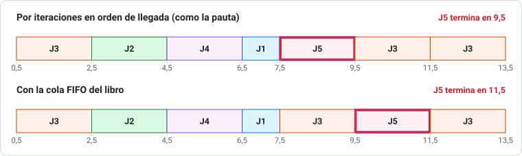

# 00 · Convenciones del profesor y errores conocidos de las pautas

> **Lee esto antes de estudiar con las pautas.** Las pruebas de Sistemas Operativos (UTEM, prof. Jorge Morris A.) usan algunas convenciones que **no son las del libro** (Silberschatz). Si no las conoces, vas a obtener resultados "distintos a la pauta" y vas a pensar que te equivocaste cuando no es así, o al revés.
>
> Todo lo de esta página se comprobó recalculando las pautas con los programas de [`herramientas/`](../herramientas/).

---

## 1. Planificación de CPU

### 1.1 Prioridad: número **menor** = prioridad **mayor**

En todas las pautas, un proceso con prioridad `0` le gana a uno con prioridad `5`. Es la misma convención del libro.

### 1.2 "SJF Preemptive" = SRTF (el más corto **restante**)

Las pautas usan los nombres de forma inconsistente: en 2013 escriben *"SJF Preemptive (No Apropiativo)"* y en 2024-2 *"SJF Preemptive (No apropiativo)"*, pero **lo que calculan es SJF apropiativo** (en cada llegada se compara la ráfaga *restante* del que corre con la del que llega, y si el nuevo es más corto, lo expulsa).

| Nombre en la prueba | Qué hacer |
|---|---|
| SJF Preemptive / SJF apropiativo / SRTF | Expulsar si llega uno con ráfaga menor a la **restante** del actual |
| SJF / SJF No Apropiativo / SJF NA | Elegir el más corto entre los que esperan y **dejarlo terminar** |

> En la prueba, escribe al lado del título cuál estás usando ("SJF apropiativo: se compara la ráfaga restante"). Así no hay ambigüedad.

### 1.3 Round Robin "por iteraciones" (vueltas)

El profesor **no usa la cola FIFO del libro**. Resuelve Round Robin por **iteraciones**: en cada vuelta atiende a los procesos **en orden de llegada** (P1, P2, P3, …), dándole a cada uno hasta un quantum, y vuelve a empezar.

En la pauta 2013 se ve explícito ("Iteración N° 1, Iteración N° 2…"). Comprobado en las pautas 2013, 2024-2, 2025-2 y 2026-1.

**¿Cuándo da distinto que el libro?** Cuando un proceso llega *mientras* otro gasta su quantum y después le toca a un proceso que ya había corrido. Ejemplo real (Prueba 1 2024-2, q = 2):

*Procesos: J3 (llega 0,5; ráfaga 6), J2 (1,3; 2), J4 (1,5; 2), J1 (1,6; 1), J5 (5,6; 2). La única diferencia es el orden de J3 y J5 después de 7,5.*

En la cola del libro, J3 volvió a la cola en 2,5 (antes de que J5 llegara en 5,6), así que va primero. En la vuelta del profesor, J5 está "más adelante en el orden de llegada" que J3 y se atiende en la primera vuelta.

> **Recomendación:** usa el método por iteraciones (es el que pide el profesor). Si quieres, agrega una nota: "RR resuelto por iteraciones en orden de llegada".

### 1.4 Tiempo de espera (W.T.): la pauta usa "inicio del último tramo − llegada"

La definición del libro es:

$$\text{W.T.} = \text{T.T.} - \text{ráfaga} \qquad\text{(tiempo total en la cola de listos)}$$

Las pautas calculan, en cambio:

$$\text{W.T.}_{\text{pauta}} = \text{(instante en que el proceso empieza su último tramo)} - \text{llegada}$$

Las dos fórmulas **coinciden si el proceso nunca fue interrumpido**. Si fue interrumpido, la de la pauta da más, porque cuenta como "espera" el rato en que el proceso sí estuvo corriendo antes.

Comprobado en: P1 2009-2, Parcial 2024-2, Recuperativa 2024-2, Examen 2025-1, P1 2025-2, Examen 2026-1 y Recuperativa 2026-1 (todas coinciden con esta regla).

Ejemplo (Recuperativa 2024-2, SJF apropiativo): Azul llega en 0,1, corre de 0,1 a 0,5, lo expulsan, y vuelve de 5,5 a 9,1.

| | Cálculo | Resultado |
|---|---|---|
| Libro | T.T. − ráfaga = 9,0 − 4 | **5,0** |
| Pauta | último inicio − llegada = 5,5 − 0,1 | **5,4** |

> **En la prueba:** escribe la fórmula que usas. Lo más seguro es calcular como la pauta (es lo que corrige el profesor) y, si te sobra tiempo, anotar el valor del libro. Si tienes dudas, **pregúntale al profesor cuál quiere**; el programa [`planificacion.py`](../herramientas/planificacion.py) te muestra las dos columnas.

### 1.5 Los decimales: "dos decimales, sin aproximar"

Algunas pautas piden truncar (5,333… → 5,33; 2,5666… → 2,56). Cuando lo pidan, **trunca, no redondees**.

---

## 2. Memoria

### 2.1 Distribución proporcional y "paginación anticipada"

En los problemas de "RAM de X MB y procesos A, B, C" el profesor:

1. Calcula los marcos de la RAM: `RAM / tamaño de bloque`.
2. Calcula las páginas de cada proceso (siempre **hacia arriba**).
3. Reparte **todos** los marcos entre los procesos en proporción a sus páginas, **truncando**:
   $a_i = \left\lfloor \dfrac{p_i}{\sum p} \cdot m \right\rfloor$
4. Como cada proceso recibe muchos más marcos que páginas, dice que es **paginación anticipada (por adelantado)**: todas las páginas se cargan una vez, no hay víctimas, y el tiempo de fallas es `páginas × (acceso + transferencia)`.

### 2.2 "Fragmentación interna acumulada"

La pauta suma **los marcos asignados que el proceso no usa** + lo que sobra en la última página:

$$F = (a_i - p_i)\cdot \text{bloque} + (p_i\cdot\text{bloque} - \text{tamaño del proceso})$$

> En el libro, la fragmentación interna de paginación es **solo lo que sobra en la última página**. Usa la fórmula de la pauta en la prueba, pero entiende la diferencia (te pueden preguntar el concepto).

### 2.3 Tiempo de fallas con reemplazo: entradas + salidas

En los problemas de reemplazo de páginas (FIFO, Óptimo, LRU) la pauta cuenta:

- una **entrada** por cada falla (se lee la página desde disco), y
- una **salida** por cada reemplazo (la víctima se escribe a disco),

$$T_{\text{fallas}} = (\text{fallas} + \text{reemplazos}) \times (t_{\text{acceso}} + t_{\text{transferencia}})$$

y lo presenta con una tabla "Página | Entradas | Salidas | Total". Comprobado en las 4 pautas que lo usan (2024-2, 2025-1, 2025-2, Recuperativa 2026-1).

Si te piden el **turnaround** del proceso (2025-2): `T_fallas + (número de referencias × tiempo de ejecución por página)`.

---

## 3. Interbloqueo (deadlock)

### 3.1 "Seguro", "inseguro reversible" e "inseguro irreversible"

Terminología del curso (apuntes, cap. 8):

| Situación en el grafo | Nombre en el curso | ¿Hay deadlock? |
|---|---|---|
| No hay ciclos | **Estado seguro** | No |
| Hay ciclo, y todos los recursos del ciclo tienen **1 instancia** | **Inseguro irreversible** | **Sí**, seguro |
| Hay ciclo, pero algún recurso del ciclo tiene **varias instancias** | **Inseguro reversible** | *Puede* que sí o que no: hay que revisar (reducir el grafo) |

> Ojo: en el libro, "estado inseguro" (banquero) y "ciclo en el grafo" son ideas distintas. El curso las mezcla. Usa los nombres del curso en la prueba.

### 3.2 Banquero: "matriz de necesidad"

En el problema de los exámenes 2025-1 y 2026-1 ("N1 = N2 = 3, Mi,j = 2"), la pauta llama "matriz de necesidad" a la de **máximos** (todo 2). La necesidad *de verdad* es `Máximo − Asignados` y cambia en cada caso. En la prueba, entrega las dos y di cuál es cuál.

---

## 4. Errores conocidos en las pautas

Recalculados con los programas de [`herramientas/`](../herramientas/). Úsalos para no "aprenderte" un error.

| Prueba | Problema | La pauta dice | Lo correcto | Por qué |
|---|---|---|---|---|
| Recuperativa 2024-2 | 3 (banquero Pa, Pb, Pc) | Inseguro si no se parte con Pb | También es **seguro partir con Pc**. Solo es inseguro partir con **Pa** | Pc necesita (2,0) y hay (2,1). Las secuencias seguras son: Pb-Pa-Pc, Pb-Pc-Pa, Pc-Pa-Pb, Pc-Pb-Pa. (La pauta 2013, con los mismos datos, sí lo decía bien) |
| Recuperativa 2024-2 | 5 (grafo) | Ciclo "P2→R4→P3→R2" | En la figura **no hay R4**. Los ciclos son P1→R1→P2→R2→P3→R3→P1 y P2→R2→P3→R3→P2 | La conclusión (interbloqueo) sí es correcta |
| Examen 2026-1 | 2 iii (permanencia del proceso A) | 8.200 ms | **8.800 ms** | 2.200 + 60 × 110 = 2.200 + 6.600 |
| P2 2024-2, P2 2025-2, Examen 2026-1 | Fragmentación de la última página (proceso A) | 410 B | **393 B** (393,375) | 3.601.333 bits = 450.166,625 B exactos; la pauta redondea a 109,9 páginas antes de multiplicar |
| P1 2025-2 | 1 (Prioridad) | T.T. de P5 = 34,9 (promedio 29,38) | **34,3** (promedio 29,26) | P5 llega en 10,9 y termina en 45,2 |
| P1 2013 forma A | 4 a) | Si Pa pide 1 de R1, "se mantiene seguro" | Si lo pide **ahora**, queda **inseguro** (Disponible (1,1) no alcanza a nadie). Si lo pide cuando ya le toca correr en la secuencia segura, sí se puede | La pregunta es ambigua: di en qué momento lo pide |
| P1 2013 forma C | 4 a) | Si Pa pide 1 de R1, inseguro irreversible | Queda **seguro**: Pa necesitaría (0,1) y hay (0,1) | Recalculado con el banquero |
| Guía, problema 32 | Datos | — | P3 tiene asignado R0 = 1 y máximo R0 = 0: **datos imposibles** (necesidad negativa) | En el Parcial 2024-2 aparece la versión corregida |

Y las diferencias de W.T. de la [sección 1.4](#14-tiempo-de-espera-wt-la-pauta-usa-inicio-del-último-tramo--llegada) (no son errores de cuenta, sino una fórmula distinta a la del libro).
