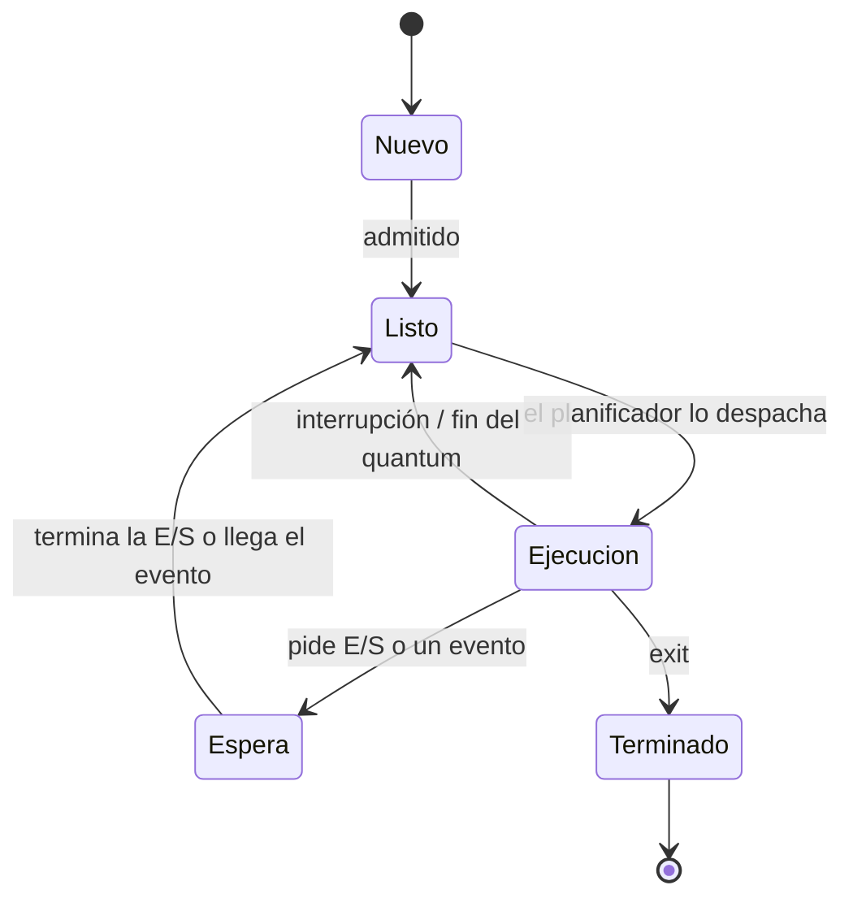

# 02 · Procesos e hilos

> Apuntes: *Cap 3 2020.pdf*. Preguntas típicas: PCB (P1 2022-2), estados y transiciones (guía 35), hilos (Parcial 2024-2), cambio de contexto (guía 43 a).

## 1. Programa vs. proceso

- Un **programa** es un archivo **pasivo** (el ejecutable en el disco).
- Un **proceso** es un programa **en ejecución**: es **activo**, tiene un contador de programa, registros, memoria y archivos abiertos.

Un mismo programa puede dar origen a varios procesos (por ejemplo, dos ventanas del navegador).

### Un proceso en memoria

```
dirección alta  ┌──────────────┐
                │    pila      │  ← variables locales, parámetros, retorno (crece hacia abajo)
                │      ↓       │
                │      ↑       │
                │    heap      │  ← memoria dinámica (malloc / new) (crece hacia arriba)
                ├──────────────┤
                │    datos     │  ← variables globales
                ├──────────────┤
                │  texto       │  ← el código
dirección baja  └──────────────┘
```

## 2. Estados de un proceso



| Estado | Significa |
|---|---|
| **Nuevo** | Se está creando |
| **Listo** (*ready*) | Tiene todo para correr, solo le falta la CPU (está en la cola de listos) |
| **Ejecución** (*running*) | Está usando la CPU. En un monoprocesador, **uno solo** a la vez |
| **Espera** (*waiting*, bloqueado) | Espera un evento (E/S, una señal); aunque le den la CPU no podría avanzar |
| **Terminado** | Terminó; el SO libera sus recursos |

> **Ojo:** de **Espera** no se pasa directo a **Ejecución**: primero vuelve a **Listo** y el planificador lo elige.

### Guía, problema 35: transiciones de un proceso

> Ráfagas: 30 ms de CPU → 6 ms de impresora → 12 ms de CPU → 10 ms de disco duro → 58 ms de CPU.

| # | Transición | Motivo |
|---|---|---|
| 1 | Nuevo → Listo | Se admite el proceso |
| 2 | Listo → Ejecución | Le dan la CPU (ráfaga de 30 ms) |
| 3 | Ejecución → Espera | Pide imprimir (E/S de 6 ms) |
| 4 | Espera → Listo | Terminó la impresión |
| 5 | Listo → Ejecución | Le dan la CPU (12 ms) |
| 6 | Ejecución → Espera | Pide el disco (10 ms) |
| 7 | Espera → Listo | Terminó la lectura o escritura |
| 8 | Listo → Ejecución | Le dan la CPU (58 ms) |
| 9 | Ejecución → Terminado | Termina |

> Si el sistema usa Round Robin y el quantum es menor que alguna ráfaga (por ejemplo, q = 20 ms con la ráfaga de 58 ms), además aparecen ciclos **Ejecución → Listo → Ejecución** cada vez que vence el quantum. Menciónalo en la prueba.

## 3. PCB: bloque de control de proceso

El SO guarda todo lo que necesita de cada proceso en su **PCB** (*Process Control Block*):

- **Estado** del proceso.
- **Contador de programa** (la próxima instrucción).
- **Registros de la CPU**.
- Información de **planificación** (prioridad, punteros a colas).
- Información de **memoria** (base y límite, tabla de páginas).
- Información **contable** (tiempo de CPU usado, límites).
- Estado de **E/S** (dispositivos asignados, archivos abiertos).

> **P1 2022-2 iii: ¿Por qué el PCB reserva lugar para los registros de la CPU?** Porque cuando el proceso **pierde la CPU** (interrupción, fin del quantum, espera de E/S), los valores de sus registros, incluido el contador de programa, se **guardan en su PCB**. Cuando vuelve a ejecutarse, se **restauran**, y el proceso continúa **exactamente donde quedó**, como si nunca lo hubieran interrumpido.

## 4. Cambio de contexto

Es **cambiar la CPU de un proceso a otro**: guardar el estado (contexto) del que sale en su PCB y cargar el estado guardado del que entra.

- Es **puro costo** (*overhead*): mientras se hace, no se ejecuta trabajo útil. Depende del hardware (cuántos registros hay que copiar).
- Por eso un quantum demasiado chico en Round Robin es malo ([03 · Planificación](03-planificacion-cpu.md#45-round-robin-rr)).

> **Guía 43 a)** *"La permutación de la CPU a otro proceso requiere guardar el estado del proceso que anteriormente se ejecutaba y cargar el estado guardado del nuevo proceso"*: es la definición de **cambio de contexto**. Agrega que es tiempo improductivo y que el estado se guarda en el PCB.

## 5. Planificadores y colas

- **Colas:** de trabajos (todos los procesos), **de listos** (en memoria, esperando CPU) y **de dispositivo** (esperando E/S).
- **Planificador de largo plazo** (de trabajos): decide **cuántos** procesos entran a memoria, o sea, el **grado de multiprogramación**. Conviene que admita una buena **mezcla** de procesos limitados por E/S y limitados por CPU.
- **Planificador de corto plazo** (de CPU): elige al siguiente de la cola de listos. Se ejecuta **muy seguido** (milisegundos), así que tiene que ser rápido.
- **Planificador de mediano plazo:** saca procesos de memoria temporalmente (**swapping**) para bajar la carga y después los vuelve a traer.

## 6. Creación y término de procesos

- Un proceso **padre** crea procesos **hijos** y se forma un **árbol de procesos**. Cada uno tiene un PID.
- En UNIX: `fork()` crea una copia del padre; `exec()` reemplaza el programa del hijo por otro; el padre puede esperar con `wait()`.
- **Término:** `exit()`. El padre puede abortar a un hijo. Un hijo terminado cuyo padre no ha hecho `wait` queda **zombi**; si el padre muere antes, el hijo queda **huérfano**.

## 7. Comunicación entre procesos (IPC)

Los procesos **independientes** no comparten datos. Los **cooperativos** sí, para compartir información, acelerar cálculos o separar el trabajo en módulos.

| Modelo | Cómo funciona | Ventaja | Desventaja |
|---|---|---|---|
| **Memoria compartida** | Una zona de memoria común; leen y escriben ahí | Muy rápido (el SO interviene solo al crearla) | Hay que **sincronizar** a mano (condiciones de carrera) |
| **Paso de mensajes** | `send(mensaje)` / `receive(mensaje)` a través del SO | Más fácil, sirve también en red | Más lento (llamada al sistema por mensaje) |

Variantes del paso de mensajes:

- **Directo** (nombras al otro proceso) o **indirecto** (a través de un buzón o puerto).
- **Bloqueante** (síncrono) o **no bloqueante**.
- **Búfer** de capacidad cero, limitada o ilimitada.

Otros mecanismos: **pipes** (comunes entre padre e hijo, o con nombre), **sockets** (IP + puerto) y **RPC** (llamar a una función en otra máquina como si fuera local).

El problema clásico de los procesos cooperativos es el **productor-consumidor**. Su solución con semáforos está en [04 · Sincronización](04-sincronizacion.md#5-productor-consumidor-búfer-limitado).

## 8. Hilos (threads)

Un **hilo** es la unidad básica de uso de la CPU dentro de un proceso.

- Cada hilo tiene su propio **contador de programa, registros y pila**.
- Los hilos de un mismo proceso **comparten el código, los datos y los archivos abiertos**.

**Ventajas:**

- **Capacidad de respuesta:** si un hilo se bloquea, los otros siguen.
- **Compartir recursos**, sin IPC.
- **Economía:** crear un hilo y cambiar entre hilos es mucho más barato que hacerlo con procesos.
- **Escalabilidad:** en un multinúcleo, los hilos corren en paralelo.

### Hilos de usuario vs. hilos de kernel

| | Hilos de usuario | Hilos de kernel (del sistema) |
|---|---|---|
| Quién los maneja | Una biblioteca, sin que el SO lo sepa | El SO los conoce y planifica |
| Si uno hace E/S bloqueante | **Se bloquea todo el proceso** (el SO solo ve un proceso) | Se bloquea **solo ese hilo** |
| Costo | Muy barato | Algo más caro (llamada al sistema) |

**Modelos:** muchos a uno, uno a uno (Linux, Windows) y muchos a muchos.

> **Parcial 2024-2, Problema 3: en un monoprocesador, ¿qué gran ventaja tiene que el sistema soporte hilos a nivel de sistema (kernel)?**
>
> Que **mientras un hilo está bloqueado en una E/S, pueden ejecutarse otros hilos del mismo proceso**. Esto es posible porque el SO reconoce los hilos como **unidades de ejecución independientes**. Con hilos solo de usuario, una E/S bloqueante de un hilo bloquearía al proceso completo.
>
> Ojo: en un monoprocesador **no** se gana paralelismo real (hay una sola CPU). La ventaja es aprovechar el tiempo de espera de E/S.
