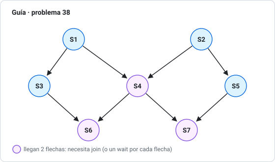
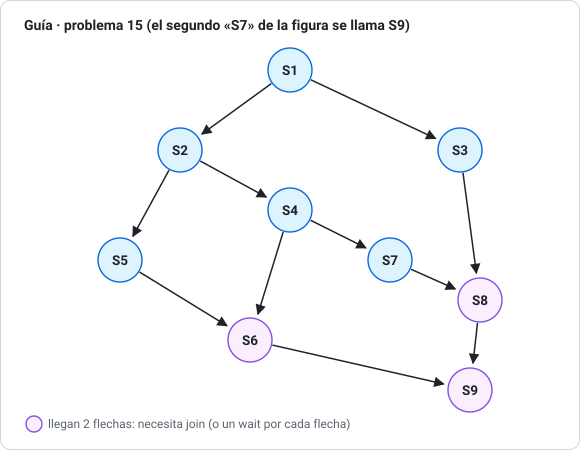

# 04 · Sincronización: sección crítica, semáforos y monitores

> **Aparece en:** Examen 2025-1 (estacionamiento con semáforos, 15 pts), Examen 2026-1 (variable X compartida, 20 pts) y en la guía (12, 15, 23, 24, 27, 34, 38, 39, 41, 42).
> Todos los programas de esta sección están en [`programas/`](programas/) y **se pueden ejecutar**: en jBACI, o en el celular con [Mini BACI](https://yhwachw.github.io/mini-baci/) (abre el `.cm` con «Abrir .cm»).

## 1. El problema: la condición de carrera

### Examen 2026-1, Problema 1 / Guía 27 (20 pts)

> Varios terminales; cada uno lo atiende un proceso, que hace `X = X + 1` por cada línea escrita. X vale **34.657**. ¿Qué pasa si dos procesos incrementan X a la vez? ¿Cómo se evita?

`X = X + 1` **no es una sola instrucción** para la CPU. Son tres:

```
LOAD  R, X      ; leer X a un registro
ADD   R, 1      ; sumar
STORE X, R      ; guardar
```

Si el SO cambia de proceso entre medio, puede pasar esto:

| Paso | Proceso A | Proceso B | X en memoria |
|---|---|---|---|
| 1 | LOAD → R = 34.657 | | 34.657 |
| 2 | *(cambio de contexto)* | LOAD → R = 34.657 | 34.657 |
| 3 | | ADD → R = 34.658 | 34.657 |
| 4 | | STORE | **34.658** |
| 5 | ADD → R = 34.658 | | 34.658 |
| 6 | STORE | | **34.658** ✗ |

Se contaron dos líneas, pero X subió **solo en 1**: **se perdió una actualización**. Esto es una **condición de carrera**: el resultado depende del orden en que se intercalan los procesos.

**Cómo se evita:** `X = X + 1` es una **sección crítica**. Hay que garantizar **exclusión mutua**: que un solo proceso a la vez la ejecute. Por ejemplo, con un **semáforo binario**:

```c
binarysem mutex = 1;
...
wait(mutex);      // entrar
X = X + 1;        // sección crítica
signal(mutex);    // salir
```

> Pruébalo: [`programas/27-contador-X.cm`](programas/27-contador-X.cm). Con `CON_MUTEX = 0` el resultado varía (34.679, 34.680, …); con `CON_MUTEX = 1` da **siempre** 34.687.

## 2. La sección crítica y sus 3 requisitos

Cada proceso tiene esta forma:

```
do {
    [sección de entrada]     ← pide permiso
    SECCIÓN CRÍTICA          ← usa lo compartido
    [sección de salida]      ← avisa que terminó
    sección restante
} while (true);
```

Una solución correcta debe cumplir:

1. **Exclusión mutua:** si un proceso está en su sección crítica, ningún otro puede estar en la suya.
2. **Progreso:** si nadie está en la sección crítica y alguien quiere entrar, la decisión no puede postergarse indefinidamente (y solo participan los que quieren entrar).
3. **Espera limitada:** hay un límite de veces que otros pueden entrar antes que un proceso que ya pidió entrar. Así **no hay inanición**.

### Soluciones por hardware

- **Deshabilitar interrupciones:** sirve solo en **monoprocesador** (sin interrupciones no hay cambio de contexto). En un multiprocesador no basta, porque otra CPU sigue corriendo.
- **Instrucciones atómicas** como `test_and_set`: leen y escriben **en un solo paso**, sin que nadie se meta entre medio. En BACI se pueden simular con `atomic` ([`programas`](programas/) / ejemplo "test_and_set" en Mini BACI).

> **P1 2025-2, Pregunta 4:** en un **multiprocesador con memoria común**, el principal problema del SO es **proteger sus propias secciones críticas** (sus tablas, colas y estructuras), porque **varios procesadores pueden ejecutar código del SO al mismo tiempo**. Con un solo procesador había, como máximo, un proceso del sistema ejecutando a la vez.

## 3. Semáforos

Un **semáforo** S es un entero que **solo** se usa con dos operaciones **atómicas**:

| Operación | Otros nombres | Qué hace |
|---|---|---|
| `wait(S)` | `P(S)`, *down*, *acquire* | Si S > 0, lo **resta** y sigue. Si S = 0, el proceso se **bloquea** (duerme en la cola de S) |
| `signal(S)` | `V(S)`, *up*, *release* | Si hay procesos dormidos en S, **despierta a uno**. Si no, **suma** 1 |

- **Semáforo binario** (`binarysem`, *mutex*): vale solo 0 o 1. Se usa para **exclusión mutua**.
- **Semáforo general o contador** (`semaphore`): cualquier valor ≥ 0. Se usa para **contar recursos** (cupos, espacios del buffer).
- En BACI, `signal` despierta a un proceso **al azar** (no en orden de llegada), como propuso Dijkstra.
- Con la versión de **cola** (bloqueo) el proceso dormido **no gasta CPU**. Con **espera activa** (*spinlock*) da vueltas preguntando: sirve solo para esperas muy cortas en multiprocesadores.

### Equivalencias (para leer las pautas en Python o C)

| Concepto | BACI / jBACI | Python (`threading`) | C (POSIX) |
|---|---|---|---|
| Semáforo contador | `semaphore s = 5;` | `threading.Semaphore(5)` | `sem_t s; sem_init(&s, 0, 5);` |
| Esperar | `wait(s);` | `s.acquire()` | `sem_wait(&s);` |
| Avisar | `signal(s);` | `s.release()` | `sem_post(&s);` |
| Mutex (binario) | `binarysem m = 1;` | `threading.Lock()` / `with m:` | `pthread_mutex_lock / unlock` |
| Procesos concurrentes | `cobegin { p(1); p(2); }` | `Thread(...).start()` + `join()` | `pthread_create` + `pthread_join` |

## 4. Los cuatro patrones que resuelven casi todo

### 4.1 Exclusión mutua: semáforo en **1**

```c
binarysem mutex = 1;
wait(mutex);  /* sección crítica */  signal(mutex);
```

### 4.2 Aviso u orden ("B no puede hacer y antes de que A haga x"): semáforo en **0**

```c
semaphore listo = 0;
// A:                 // B:
x;                    wait(listo);
signal(listo);        y;
```

**Guía 24:** P2 ejecuta `e` solo si P1 ya hizo `a` **o** P3 ya hizo `g`. Basta **un** semáforo en 0 al que **ambos** le hacen signal ([`24-e-despues-de-a-o-g.cm`](programas/24-e-despues-de-a-o-g.cm)):

| P1 | P2 | P3 |
|---|---|---|
| a; | d; | g; |
| **signal(permiso);** | **wait(permiso);** | **signal(permiso);** |
| b; c; | e; f; | h; i; |

> Con "**o**" basta que llegue **uno** de los dos signal. Si fuera "**y**" (después de a **y** de g), P2 tendría que hacer `wait` **dos veces**, o usar dos semáforos.

**Guía 39 (número combinatorio):** P2 no puede dividir `x/y` hasta que P1 termine `x`. Un semáforo `xlisto = 0`: P1 hace `signal(xlisto)` al terminar el ciclo y P2 hace `wait(xlisto)` justo antes del `printf` ([`39-combinatorio.cm`](programas/39-combinatorio.cm)).

### 4.3 Contar recursos: semáforo en **N**

```c
semaphore cupos = 5;   // 5 espacios
wait(cupos);  /* uso un espacio */  signal(cupos);
```

**Examen 2025-1, Problema 4: estacionamiento de 5 autos con una sola barrera.**

- `cupos = 5` (contador): si hay 5 dentro, el sexto **espera**.
- `barrera = 1` (binario): **un auto a la vez** por la barrera, para entrar o salir.
- El orden importa: primero `wait(cupos)` y **después** `wait(barrera)`. Si se invierte, un auto podría tomar la barrera y quedarse esperando cupo **con la barrera tomada**: los que quieren salir no podrían pasar y habría **deadlock**.

```c
semaphore cupos = 5;
binarysem barrera = 1;

void autoResidente(int id) {
    wait(cupos);                    // espera un espacio libre
    wait(barrera);  /* entra */  signal(barrera);
    /* estacionado */
    wait(barrera);  /* sale  */  signal(barrera);
    signal(cupos);                  // libera su espacio
}
```

La pauta lo resuelve en Python (`Semaphore(5)` + `Lock`) y en C (`sem_t` + `pthread_mutex_t`). La versión en C-- para jBACI está en [`programas/ejercicios-jbaci/05-estacionamiento-examen-2025-1.cm`](programas/ejercicios-jbaci/05-estacionamiento-examen-2025-1.cm).

> ⚠ Esa versión tiene un detalle: el ciclo `for (t = 1; t <= 5; t++) { dentro = dentro; }` lee y escribe `dentro` **fuera** de la barrera, lo que es una pequeña condición de carrera que a veces da "Autos dentro: −3". Deja el ciclo vacío o protege `dentro` con la barrera.

**Guía 41 (parque, 500 vehículos, un guardia):** es el mismo patrón con tres semáforos ([`41-parque.cm`](programas/41-parque.cm)):

| Paso del enunciado | Sincronización |
|---|---|
| 1-3. Botón, ticket y barrera (de uno en uno) | `wait(barrera)` … `signal(barrera)` |
| La barrera sube solo si no se excede el límite | `wait(cupos)` con `cupos = 500` |
| 4. Un único guardia guía a un auto a la vez | `wait(guardia)` … `signal(guardia)` |
| 5. Mirar los buitres y correr | Nada (no comparte nada) |
| 6. Salir | `signal(cupos)` |

### 4.4 Turnos en cadena: un semáforo **por proceso**

**Guía 42:** procesos A, B y C imprimen "Soy el proceso x". Se quiere un orden fijo.

| Orden | Idea | Programa |
|---|---|---|
| a) ABC, ABC… | sA = 1, sB = 0, sC = 0. Cada uno espera su semáforo y hace signal al del siguiente (C le avisa a A) | [`42a-orden-ABC.cm`](programas/42a-orden-ABC.cm) |
| b) ABBC, ABBC… | A hace `signal(sB)` **dos veces**. Cada B avisa con `signal(listoB)`. C hace `wait(listoB)` **dos veces** y después `signal(sA)` | [`42b-orden-ABBC.cm`](programas/42b-orden-ABBC.cm) |
| c) ACBA, ACBA… | A trabaja dos veces por vuelta: `wait(sA)`, A, `signal(sC)` (primera A); luego `wait(sA)`, A, `signal(sA)` (segunda A). C: `wait(sC)`, C, `signal(sB)`. B: `wait(sB)`, B, `signal(sA)` | [`42c-orden-ACBA.cm`](programas/42c-orden-ACBA.cm) |

> Las tres soluciones se probaron 3.000 veces cada una y **siempre** dan el orden pedido.

## 5. Productor-consumidor (búfer limitado)

```c
semaphore vacios = N;    // espacios libres
semaphore llenos = 0;    // espacios ocupados
binarysem mutex  = 1;    // acceso al búfer

productor:                      consumidor:
  wait(vacios);                   wait(llenos);
  wait(mutex);                    wait(mutex);
  poner en el búfer;              sacar del búfer;
  signal(mutex);                  signal(mutex);
  signal(llenos);                 signal(vacios);
```

**Guía 34: ¿es correcto si el productor hace `P(exclusión)` antes de `P(vacíos)`?** **No.** Si el búfer está **lleno**, el productor toma la exclusión y se duerme en `vacíos` **con la exclusión tomada**. El consumidor nunca puede entrar a sacar algo para liberar espacio: **deadlock**. Regla: **primero el semáforo que cuenta y después el mutex**. En [`34-productor-consumidor-mal.cm`](programas/34-productor-consumidor-mal.cm), la versión mala se trabó en 293 de 3.000 ejecuciones y la corregida (`CORREGIDO = 1`) en ninguna.

## 6. Monitores

Un **monitor** agrupa variables compartidas y los procedimientos que las usan. **Solo un proceso a la vez** puede estar dentro: la exclusión mutua la da el monitor solo, sin `wait`/`signal` manuales.

Para esperar una condición dentro del monitor se usan **variables condición**:

- `waitc(c)`: el proceso **se duerme y suelta el monitor**, para que otro pueda entrar.
- `signalc(c)`: **despierta a uno** de los que esperan en c. Si nadie espera, **no hace nada**. A diferencia de `signal` de un semáforo, **no se acumula**.
- `empty(c)`: 1 si nadie espera en c.
- **Semántica de Hoare** (la de BACI): el despertado entra **de inmediato** y el que hizo `signalc` espera a que se lo devuelvan. Por eso `signalc` suele ir al **final** del procedimiento.

```c
monitor Impresora {
    int ocupada;
    condition libre;
    void tomar()  { if (ocupada) waitc(libre); ocupada = 1; }
    void soltar() { ocupada = 0; signalc(libre); }
    init { ocupada = 0; }
}
```

| | Semáforos | Monitores |
|---|---|---|
| Exclusión mutua | Manual (`wait`/`signal` en cada lugar) | Automática |
| Riesgo | Olvidar un signal o invertir el orden → deadlock | Menos errores; todo el control está en un solo lugar |
| Esperar algo | `wait` en un semáforo en 0 | `waitc` en una condición |

## 7. Concurrencia y precedencia

### 7.1 Condiciones de Bernstein: ¿pueden ir en paralelo?

Para cada sentencia S: **R(S)** = variables que **lee**, **W(S)** = variables que **escribe**. S1 y S2 pueden ejecutarse concurrentemente si:

$$R(S_1)\cap W(S_2) = \varnothing \quad\land\quad W(S_1)\cap R(S_2) = \varnothing \quad\land\quad W(S_1)\cap W(S_2) = \varnothing$$

**Guía 12:**

| Par | R y W | ¿Concurrentes? |
|---|---|---|
| i. `x := x + 3` y `z := x * 2` | W(S1) = {x}, R(S2) = {x} | **No**: S2 lee la x que escribe S1 |
| ii. `z := sqrt(2x/4)` y `x := 32 * z` | R(S1) = {x} y W(S2) = {x}; W(S1) = {z} y R(S2) = {z} | **No**: cada una lee lo que escribe la otra |

**Guía 23:** en `parbegin a := b + c; d := b*c − x; e := a/b + n**2 parend`, la tercera sentencia **lee `a`**, que escribe la primera. El valor de `e` depende de cuál se ejecute antes: es una **condición de carrera** y por eso resulta inaceptable. La segunda no tiene problema con ninguna.

### 7.2 Grafos de precedencia con fork/join

- `fork L`: crea un flujo **nuevo** que empieza en la etiqueta L; el actual sigue.
- `join cont`: `cont := cont − 1` (atómico); si no llegó a 0, **este flujo termina**. El último en llegar sigue.
- Truco: pon un contador por cada nodo al que llega **más de una** flecha, inicializado en el número de flechas que llegan.

**Guía 38:** aristas S1→S3, S1→S4, S2→S4, S2→S5, S3→S6, S4→S6, S4→S7, S5→S7.



```
        c4 := 2;  c6 := 2;  c7 := 2;
        fork A2;            // S1 y S2 empiezan juntos
        S1;
        fork A3;
        goto A4;
A2:     S2;
        fork A5;
        goto A4;
A3:     S3;   goto A6;
A5:     S5;   goto A7;
A4:     join c4;            // espera a S1 y a S2
        S4;
        fork A6;
        goto A7;
A6:     join c6;  S6;  quit;   // espera a S3 y a S4
A7:     join c7;  S7;  quit;   // espera a S4 y a S5
```

La misma precedencia **con semáforos** (un semáforo por arista, en 0: cada nodo hace `wait` por cada flecha que le llega y `signal` por cada una que sale) está en [`38-grafo-precedencia.cm`](programas/38-grafo-precedencia.cm). Se probó 3.000 veces y nunca viola el orden.

**Guía 15** (la figura tiene **dos nodos "S7"**; llamamos **S9** al de abajo a la derecha). Aristas: S1→S2, S1→S3, S2→S4, S2→S5, S4→S7, S4→S6, S5→S6, S7→S8, S3→S8, S6→S9, S8→S9.



```
        c6 := 2;  c8 := 2;  c9 := 2;
        S1;
        fork B3;
        S2;
        fork B5;
        S4;
        fork B6;
        S7;
        goto B8;
B3:     S3;   goto B8;
B5:     S5;   goto B6;
B6:     join c6;  S6;  goto B9;   // S4 y S5
B8:     join c8;  S8;  goto B9;   // S7 y S3
B9:     join c9;  S9;             // S6 y S8
```

### 7.3 cobegin / parbegin

`cobegin { S1; S2; S3; }` (en Pascal, `parbegin … parend`) ejecuta las sentencias **concurrentemente** y continúa cuando **todas** terminan. Solo sirve para grafos "bien anidados"; para grafos como el 38 se combina con semáforos.

## 8. Errores típicos

- Invertir el orden de los `wait`: **primero el que cuenta, después el mutex**. Si no, hay riesgo de deadlock.
- Olvidar un `signal`: el siguiente se queda esperando para siempre.
- Usar un `binarysem` donde hace falta contar (por ejemplo, para 5 cupos).
- Leer o escribir la variable compartida **fuera** de la sección crítica (el error del ejercicio 05).
- Confundir `signalc` (se pierde si nadie espera) con `signal` (se acumula).
