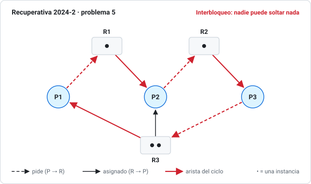
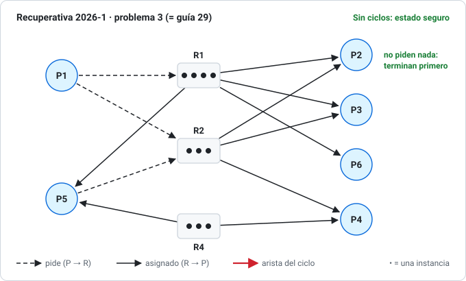
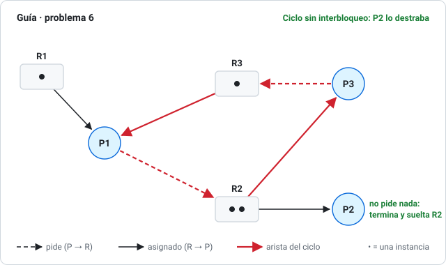

# 05 · Interbloqueo (deadlock)

> **Aparece en casi todas las pruebas**: algoritmo del banquero (P1 2009, 2013, 2022, 2024; Examen 2025-1 y 2026-1; Recuperativa 2024-2) y grafos de asignación (Recuperativa 2024-2 y 2026-1; guía 5, 6, 7, 18, 29).
> Apuntes: *Cap 8-2020.pdf*. Ver también la [terminología del curso](00-convenciones-del-profesor.md#3-interbloqueo-deadlock).

## 1. ¿Qué es?

Un conjunto de procesos está en **interbloqueo** (*deadlock*, "abrazo mortal") cuando **cada uno espera un recurso que tiene otro del mismo conjunto**, y por lo tanto ninguno puede avanzar nunca.

Ejemplo cotidiano: dos autos se encuentran en un puente de una vía; cada uno ocupa la mitad y necesita la mitad del otro.

Cada proceso usa un recurso siempre en el orden **solicitud → uso → liberación**.

## 2. Las cuatro condiciones (deben darse **las cuatro a la vez**)

| Condición | Significa | Ejemplo |
|---|---|---|
| **Exclusión mutua** | Un recurso solo puede usarlo un proceso a la vez | Una impresora |
| **Retención y espera** | Un proceso tiene al menos un recurso y espera otro | Tengo la impresora y pido el escáner |
| **Sin expropiación** (*no preemption*, "sin prevaciado") | El SO no puede quitarle un recurso a un proceso; solo se libera voluntariamente | No se le quita la impresora a mitad de un trabajo |
| **Espera circular** | Existe P0 → P1 → … → Pn → P0, donde cada uno espera algo que tiene el siguiente | P1 espera a P2, P2 espera a P1 |

> **En la prueba** (Recuperativa 2024-2, "usando las condiciones básicas"): nombra y explica **las cuatro** aplicadas al caso, y muestra el **ciclo** concreto. Eso da casi todo el puntaje.

## 3. Grafo de asignación de recursos

- Procesos = círculos (P1, P2…). Recursos = rectángulos con un punto por **instancia**.
- **Arista de solicitud** `Pi → Rj` = vector `(Pi, Rj)`: Pi **pide** una instancia de Rj.
- **Arista de asignación** `Rj → Pi` = vector `(Rj, Pi)`: una instancia de Rj **está asignada** a Pi.

En los dibujos de esta sección, la flecha **punteada** es una solicitud, la **continua** es una asignación y la **roja** es parte de un ciclo.

### Cómo decidir (reglas del curso)

1. **¿Hay ciclos?** Si no hay → **estado seguro**, no hay deadlock.
2. Si hay un ciclo y **todos** los recursos del ciclo tienen **1 instancia** → **deadlock** ("**inseguro irreversible**").
3. Si hay un ciclo pero algún recurso tiene **varias instancias** → **puede** haber deadlock ("**inseguro reversible**"). Para saberlo, **reduce el grafo**:
   - Busca un proceso que **no pida nada**, o cuyas solicitudes se puedan atender con instancias **libres**.
   - Ese proceso termina y **devuelve todo** lo que tenía (borra sus aristas).
   - Repite. Si todos terminan, no hay deadlock. Los que nunca pueden terminar están interbloqueados.

> Comprueba con `python herramientas/grafo.py` (busca ciclos y reduce el grafo).

### 3.1 Recuperativa 2024-2, Problema 5 (25 pts)

Del dibujo: R1 (1 instancia), R2 (1 instancia), R3 (2 instancias).

| Proceso | Tiene | Pide |
|---|---|---|
| P1 | 1 de R3 | R1 |
| P2 | R1 y 1 de R3 | R2 |
| P3 | R2 | R3 |

- **Ciclos:** P1 → R1 → P2 → R2 → P3 → R3 → P1 y P2 → R2 → P3 → R3 → P2.
- R3 tiene 2 instancias, pero **las dos** las tienen P1 y P2, que están esperando. P3 pide R3 y nadie la va a soltar. Al reducir, **nadie** puede terminar.
- **Las 4 condiciones:** exclusión mutua (los recursos no se comparten), retención y espera (cada proceso tiene uno y pide otro), sin expropiación (el SO no los quita), espera circular (los ciclos anteriores).
- **Estado: interbloqueo, inseguro irreversible.**

> La pauta menciona un ciclo "P2 → R4 → P3 → R2", pero en la figura **no existe R4**. La conclusión sí es correcta.

### 3.2 Recuperativa 2026-1, Problema 3 (= Guía, problema 29)

`V = {(P1,R1); (P1,R2); (R1,P2); (R2,P2); (R2,P3); (R2,P4); (R1,P5); (P5,R2); (R1,P3); (R4,P4); (R4,P5); (R1,P6)}`, con R1 = 4, R2 = 3, R3 = 1, R4 = 3 instancias.

| Proceso | Tiene | Pide |
|---|---|---|
| P1 | — | R1, R2 |
| P2 | R1, R2 | — |
| P3 | R1, R2 | — |
| P4 | R2, R4 | — |
| P5 | R1, R4 | R2 |
| P6 | R1 | — |

- **No hay ciclos:** los que piden (P1, P5) esperan recursos que tienen procesos que **no piden nada** (P2, P3, P4, P6).
- P2, P3, P4 y P6 terminan y liberan; después P5 obtiene R2, y al final P1 obtiene R1 y R2.
- **Estado: seguro.** Secuencia posible: P2, P3, P4, P6, P5, P1.

### 3.3 Guía, problemas 5, 6 y 7

*El problema 6 es el ejemplo clave de "ciclo **sin** interbloqueo": compáralo con el de la [recuperativa 2024-2](#31-recuperativa-2024-2-problema-5-25-pts), donde nadie fuera del ciclo puede soltar nada.*

| Problema | Qué hay | Resultado |
|---|---|---|
| **5**: (r1,p1); (r2,p2); (r2,p3); (r3,p1); (r2,p1); (p3,r3) | Solo P3 pide algo (R3, que tiene P1), y P1 no pide nada | **Sin ciclos: seguro.** P1 termina, libera R3 y P3 sigue |
| **6**: (r1,p1); (r2,p2); (r2,p3); (r3,p1); (p1,r2); (p3,r3) | Ciclo P1 → R2 → P3 → R3 → P1, pero R2 tiene 2 instancias y una la tiene P2, que no pide nada | **Ciclo sin deadlock: inseguro reversible.** P2 termina, libera R2 y P1 la toma; P1 termina, libera R3 y P3 sigue |
| **7**: R1 = 3, R2 = 1, R3 = 1 | Ciclo P1 → R2 → P3 → R3 → P1, con R2 y R3 de **1 instancia** | **Deadlock: inseguro irreversible.** Solo P2 puede terminar; P1 y P3 quedan interbloqueados, y P4 queda esperando R2 para siempre |

---

## 4. Cómo se maneja el deadlock

| Estrategia | Idea | Costo |
|---|---|---|
| **Prevención** | Romper **una** de las 4 condiciones (ver abajo) | Baja la utilización de recursos |
| **Evitación** | Antes de asignar, comprobar que el sistema siga en **estado seguro** (banquero) | Hay que conocer los máximos de antemano |
| **Detección y recuperación** | Dejar que ocurra, detectarlo y matar procesos o quitarles recursos | Hay que revisar periódicamente y "deshacer" trabajo |
| **Ignorarlo** (algoritmo del avestruz) | Suponer que no pasa | Lo que hacen Windows y Linux para la mayoría de los recursos |

### Prevención: cómo romper cada condición

- **Exclusión mutua:** solo se puede con recursos compartibles (archivos de solo lectura). Una impresora no se puede compartir.
- **Retención y espera:** pedir **todos** los recursos al inicio, o soltar todo antes de pedir más. Tiene baja utilización y riesgo de inanición.
- **Sin expropiación:** si un proceso pide algo que no le pueden dar, **suelta todo lo que tiene** y reintenta después.
- **Espera circular:** **numerar** los tipos de recursos y pedirlos siempre en **orden creciente**. Es la más usada en la práctica.

### Guía 25: ¿detección o prevención para la red de la empresa 2YK?

En una red (sistema distribuido) **detectar** es caro: hay que juntar el estado de todas las máquinas para armar un grafo global, con mensajes y retardos, y se pueden detectar "falsos deadlocks". Conviene **prevención**, y la más práctica es **ordenar los recursos** (romper la espera circular), porque no obliga a pedir todo por adelantado ni a expropiar.

### Guía 31: ¿por qué detectar es más caro en un sistema distribuido?

Porque ningún nodo ve el estado completo. Hay que **enviar mensajes** para construir el grafo de espera global, la información llega con **retardo** (puede estar desactualizada y dar ciclos que ya no existen o no ver uno real) y los recursos y procesos están repartidos entre máquinas. En un sistema centralizado, el SO tiene todo en su propia memoria.

### Guía 13: 4 instancias de un recurso, 3 procesos, cada uno necesita como máximo 2

**No puede haber deadlock.** En el peor caso cada proceso tiene 1 y pide otra: 3 asignadas y **queda 1 libre**. Esa instancia completa a algún proceso, que termina y libera 2, y así sucesivamente.

Regla general: con *n* procesos que necesitan como máximo *m* cada uno, no hay deadlock si las instancias son al menos $n\,(m-1) + 1$. Aquí: 3·1 + 1 = 4 ✓.

---

## 5. Algoritmo del banquero (evitación)

### Las matrices

| Nombre | Qué es |
|---|---|
| **Asignados** (*Allocation*) | Lo que cada proceso tiene **ahora** |
| **Máximo** (*Max*) | Lo **máximo** que cada proceso dice que podría necesitar |
| **Necesidad** (*Need*) | `Máximo − Asignados`: lo que **le falta** para poder terminar |
| **Disponible** (*Available*) | `Total − suma de Asignados`: lo libre ahora |

### Algoritmo de seguridad (lo que se hace en todas las pruebas)

1. Calcula **Necesidad** y **Disponible**. Verifica que Asignados ≤ Máximo y que la suma de Asignados no pase del Total.
2. Busca un proceso **no terminado** con **Necesidad ≤ Disponible** (componente a componente).
3. Si existe: "termina" y **devuelve** lo suyo: `Disponible = Disponible + Asignados`. Anótalo en la secuencia.
4. Repite el paso 2. Si **todos** terminan, el estado es **seguro** y la secuencia encontrada es una **secuencia segura**. Si quedan procesos que no caben, es **inseguro**.

> Recorre los procesos en orden (P0, P1, …) y toma el **primero** que cabe, como en las pautas. Puede haber **varias** secuencias seguras; con una basta para decir que es seguro. `python herramientas/banquero.py` las encuentra todas.

### Solicitud de recursos (¿se puede conceder ya?)

Si Pi pide `Solicitud`:

1. Si `Solicitud > Necesidad[i]` → error, pide más de lo que declaró.
2. Si `Solicitud > Disponible` → debe **esperar**.
3. **Simula** la asignación: `Asignados[i] += Solicitud`, `Disponible −= Solicitud`. Corre el algoritmo de seguridad: si queda **seguro, se concede**; si no, se rechaza y Pi espera.

---

## 6. Ejercicios de banquero resueltos

### 6.1 Parcial N°1 2024-2, Problema 1 (35 pts)

Total: R0 = 5, R1 = 3, R2 = 4.

| Proceso | Asignados | Máximo | Necesidad |
|---|---|---|---|
| P0 | 1 0 0 | 4 2 3 | 3 2 3 |
| P1 | 0 1 2 | 2 2 3 | 2 1 1 |
| P2 | 3 0 0 | 4 2 1 | 1 2 1 |
| P3 | 0 1 0 | 0 2 2 | 0 1 2 |
| Suma | 4 2 2 | | |

Disponible = (5,3,4) − (4,2,2) = **(1, 1, 2)**

| Paso | ¿Quién cabe? | Disponible después |
|---|---|---|
| 1 | P0 (3,2,3)? no. P1 (2,1,1)? no (R0). P2 (1,2,1)? no (R1). **P3 (0,1,2) ≤ (1,1,2) ✓** | (1,1,2) + (0,1,0) = **(1,2,2)** |
| 2 | P0? no. P1? no (R0). **P2 (1,2,1) ≤ (1,2,2) ✓** | + (3,0,0) = **(4,2,2)** |
| 3 | P0 (3,2,3)? no (R2). **P1 (2,1,1) ✓** | + (0,1,2) = **(4,3,4)** |
| 4 | **P0 (3,2,3) ✓** | + (1,0,0) = **(5,3,4)** = Total ✓ |

**Estado seguro. Secuencia: P3, P2, P1, P0** (es la única).

### 6.2 Recuperativa 2024-2 / P1 2013 forma A (20 pts)

R1 = 5, R2 = 6 instancias.

| Proceso | Asignados | Máximo | Necesidad |
|---|---|---|---|
| Pa | 1 0 | 2 2 | 1 2 |
| Pb | 1 3 | 3 4 | 2 1 |
| Pc | 1 2 | 3 2 | 2 0 |

Disponible = (5,6) − (3,5) = **(2, 1)**.

- Pa (1,2)? **No** (R2: 2 > 1).
- Pb (2,1)? **Sí** → Disponible (3,4).
- Pc (2,0)? **También sí**: 2 ≤ 2 y 0 ≤ 1.

**Estado seguro.** Secuencias seguras: **Pb-Pa-Pc, Pb-Pc-Pa, Pc-Pa-Pb, Pc-Pb-Pa**. La única forma de quedar inseguro es **partir con Pa**.

> La pauta 2024-2 dice "inseguro si se parte con un proceso distinto de Pb", pero **partir con Pc también es seguro** ([errores conocidos](00-convenciones-del-profesor.md#4-errores-conocidos-en-las-pautas)). La pauta 2013 lo dice bien: "solo si se elige Pa para comenzar".
>
> **a) ¿Qué pasa si Pa pide una instancia de R1?** Depende de **cuándo**:
> - **Ahora:** Pa queda con (2,0) y Disponible (1,1). Necesidades: Pa (0,2), Pb (2,1), Pc (2,0). Nadie cabe → **inseguro, no se concede**.
> - **Cuando le toca correr en la secuencia segura** (después de Pb y Pc): sobra de todo, **se concede sin problema** (esto es lo que responde la pauta).

### 6.3 P1 2022-2, Problema 4 (sin pauta): 12 instancias de R0

| Proceso | Asignados | Máximo | Necesidad |
|---|---|---|---|
| P0 | 2 | 10 | 8 |
| P1 | 4 | 6 | 2 |
| P2 | 3 | 4 | 1 |

Disponible = 12 − 9 = 3. **P1 pide 1**: 1 ≤ Necesidad 2 y 1 ≤ Disponible 3 → simulamos: P1 tiene 5, Necesidad de P1 = 1, Disponible = 2.

- P1 (1 ≤ 2) termina → Disponible 7. P2 (1 ≤ 7) → 10. P0 (8 ≤ 10) → 12.
- **Sigue seguro → se concede.** Secuencia: P1, P2, P0.

### 6.4 P1 2009-2, Problema 1 (30 pts): 4 tipos de recurso

| Proceso | Asignados (A B C D) | Máximo | Necesidad |
|---|---|---|---|
| P0 | 0 0 1 2 | 0 0 1 2 | 0 0 0 0 |
| P1 | 1 0 0 0 | 1 7 5 0 | 0 7 5 0 |
| P2 | 1 3 5 4 | 2 3 5 6 | 1 0 0 2 |
| P3 | 0 6 3 2 | 0 6 5 2 | 0 0 2 0 |
| P4 | 0 0 1 4 | 0 6 5 6 | 0 6 4 2 |

Disponible = **(1, 5, 2, 0)**.

- **¿Seguro?** Sí. Por ejemplo P0 → (1,5,3,2) → P2 → (2,8,8,6) → P1 → (3,8,8,6) → P3 → (3,14,11,8) → P4 → (3,14,12,12). Es la secuencia de la pauta: **P0, P2, P1, P3, P4** (hay 36 secuencias seguras).
- **¿Se concede P1 (0,4,2,0)?** 0,4,2,0 ≤ Necesidad (0,7,5,0) ✓ y ≤ Disponible (1,5,2,0) ✓. Simulado: Disponible (1,1,0,0), Necesidad P1 (0,3,3,0). Secuencia P0, P2, P3, P4, P1 → **seguro, se concede de inmediato**.

### 6.5 Exámenes 2025-1 y 2026-1: N1 = N2 = 3, Mi,j = 2 (20-30 pts)

Tres procesos, dos recursos con 3 instancias cada uno, todos con **máximo 2 de cada recurso**.

**a) Matriz de "necesidad máxima"** (así la llama la pauta): todo 2. La necesidad *de verdad* (`Máximo − Asignados`) depende de cada caso:

| | Caso 1 Asign. → Nec. | Caso 2 Asign. → Nec. | Caso 3 Asign. → Nec. |
|---|---|---|---|
| P1 | 2 2 → **0 0** | 1 1 → 1 1 | 2 0 → 0 2 |
| P2 | 1 1 → 1 1 | 1 1 → 1 1 | 1 1 → 1 1 |
| P3 | 0 0 → 2 2 | 1 1 → 1 1 | 0 2 → 2 0 |

En los tres casos la suma de asignados es (3,3), así que **Disponible = (0, 0)**.

- **Caso 1, seguro:** P1 ya tiene todo (necesidad 0,0), termina y libera (2,2). Después P2 (1,1) y luego P3 (2,2). Secuencias **P1, P2, P3** y **P1, P3, P2**.
- **Caso 2, inseguro:** todos necesitan (1,1) y no hay nada libre.
- **Caso 3, inseguro:** P1 necesita (0,2), P2 (1,1) y P3 (2,0); con (0,0) nadie cabe.

### 6.6 Guía, problemas 1, 2, 16 y 32

| Problema | Disponible inicial | Resultado | Una secuencia segura |
|---|---|---|---|
| 1 | (3,3,2) | Seguro | P1, P3, P4, P0, P2 |
| 2 | (3,3,2) | Seguro (justo) | P2, P1, P3, P4, P0 |
| 16 | (5,6,10) | Seguro (cualquier orden sirve) | P0, P1, P2, P3, P4 |
| 32 | (1,0,3) | **Datos imposibles**: P3 tiene R0 = 1 asignado, pero su máximo es R0 = 0 | — |

> En el problema 32, si corriges P3 a Asignados (0,1,0), como en el Parcial 2024-2, se resuelve igual que en la [sección 6.1](#61-parcial-n1-2024-2-problema-1-35-pts).

---

## 7. Detección y recuperación (teoría)

- **Detección con 1 instancia por recurso:** se usa el **grafo de espera** (*wait-for*), que deja solo los procesos (Pi → Pj si Pi espera a Pj). Hay deadlock si y solo si hay un ciclo.
- **Detección con varias instancias:** un algoritmo parecido al banquero, pero con las **solicitudes actuales** en vez de los máximos.
- **Recuperación:**
  - **Abortar procesos:** todos los del ciclo, o de a uno hasta romperlo.
  - **Expropiar recursos:** elegir una víctima, hacerle *rollback* y cuidar que no sea siempre la misma (inanición).
