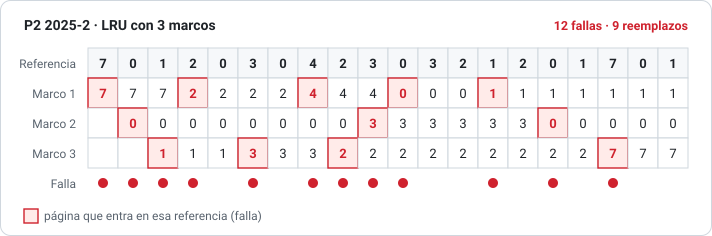
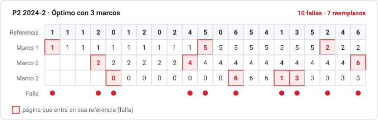
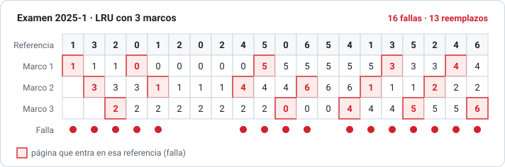
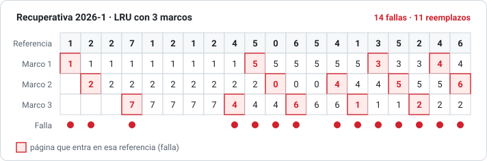

# 07 · Memoria virtual y reemplazo de páginas

> **Aparece en P2 2024-2, Examen 2025-1, P2 2025-2, Recuperativa 2026-1 y en la guía (11, 36, 9, 43).**
> El ejercicio típico: una **cadena de referencias**, 3 o 4 marcos y un algoritmo (FIFO, Óptimo o LRU). Se pide el número de fallas y el tiempo.

## 1. La idea

La **memoria virtual** permite ejecutar un proceso **sin tenerlo entero en la RAM**: solo se cargan las páginas que se usan. Gracias a eso:

- un programa puede ser **más grande que la RAM**, y
- caben **más procesos a la vez**, lo que permite más multiprogramación.

Funciona por el **principio de localidad**: en un intervalo de tiempo, un programa usa solo una parte pequeña de sus páginas (un ciclo, una función, un arreglo).

> **Guía 43 b)** "Una técnica que permite simular más memoria de la que realmente existe…" = **memoria virtual**.
>
> **P1 2009 e) / P1 2022-2 P2:** sin memoria virtual, un proceso **más grande que la RAM no puede ejecutarse**, porque debe cargarse completo. **Sí puede haber multiprogramación**, pero limitada a los procesos que quepan **completos** a la vez en la memoria.

## 2. Paginación por demanda vs. anticipada

| | Por demanda | Anticipada (por adelantado) |
|---|---|---|
| Cuándo se carga una página | Solo cuando se usa (al producirse una **falla**) | Se cargan **todas** (o muchas) de una vez al comenzar |
| Ventaja | Ahorra **espacio** en memoria | Ahorra **tiempo** de acceso (no hay fallas después) |
| Desventaja | Muchas fallas al principio | Puede cargar páginas que nunca se usan |

> **Examen 2025-1, pregunta 4 / Guía 43 d):** la **A** es correcta: *"La paginación por demanda privilegia el espacio en memoria, mientras que la paginación por adelantado privilegia el tiempo de acceso"*.

Cada entrada de la tabla de páginas tiene un **bit de validez**. Si es 0 (la página no está en RAM) y el proceso la usa, se produce una **falla de página** (*page fault*).

## 3. Rutina de falla de página (P2 2025-2, Pregunta 1, 10 pts)

1. El proceso referencia una página con bit inválido y el hardware genera un **trap** al SO.
2. El SO revisa que la referencia sea válida. Si no lo es, aborta el proceso.
3. Busca **en qué lugar del disco** está la página.
4. Busca un **marco libre**:
   - Si hay uno, lo usa.
   - Si no hay, ejecuta el **algoritmo de reemplazo** para elegir una **víctima**, la **escribe a disco** (si fue modificada) y actualiza la tabla de páginas.
5. **Lee** la página desde el disco al marco obtenido.
6. **Actualiza la tabla de páginas** (marco y bit válido).
7. **Reinicia la instrucción** que causó la falla y vuelve al proceso.

**Tiempo efectivo de acceso:** $T_{ef} = (1-p)\cdot t_{mem} + p\cdot t_{falla}$, donde *p* es la probabilidad de falla. Como una falla cuesta milisegundos y un acceso a memoria nanosegundos, incluso un *p* pequeño hace todo mucho más lento.

---

## 4. Algoritmos de reemplazo

| Algoritmo | A quién saca (la víctima) | Comentario |
|---|---|---|
| **FIFO** | La que **entró hace más tiempo** | Simple. Puede empeorar con más marcos (**anomalía de Belady**) |
| **Óptimo (OPT)** | La que **más tarde se volverá a usar** (o nunca) | El mejor posible, pero necesita conocer el futuro. Sirve para comparar |
| **LRU** | La que **hace más tiempo que no se usa** | Aproxima al óptimo mirando el pasado. Necesita hardware (contadores o pila) |

> **Anomalía de Belady:** con FIFO, **más marcos pueden dar más fallas**. Con la cadena 1, 2, 3, 4, 1, 2, 5, 1, 2, 3, 4, 5, FIFO tiene **9 fallas con 3 marcos** y **10 con 4 marcos**. Compruébalo con `python herramientas/reemplazo.py fifo 3 "1,2,3,4,1,2,5,1,2,3,4,5"` y luego con 4. Óptimo y LRU nunca tienen esta anomalía.

### Cómo resolverlo a mano

1. Dibuja una tabla: una **columna por referencia** y una **fila por marco**.
2. Para cada referencia:
   - Si la página **ya está** en algún marco, no hay falla: copia la columna anterior.
   - Si **no está** y hay un marco **vacío**, la pones ahí. Es una falla.
   - Si **no está** y todo está lleno, aplicas el algoritmo para elegir la víctima y la reemplazas. Es una falla y un reemplazo.
3. Marca con `*` cada falla.
4. **LRU:** para elegir la víctima, mira **hacia atrás** en la cadena: la página cuyo último uso está más lejos es la víctima.
5. **Óptimo:** mira **hacia adelante**: la víctima es la que se vuelve a usar más tarde. Si alguna **nunca** se vuelve a usar, esa es la víctima.

### Tiempo en fallas (criterio de las pautas)

$$T = (\text{fallas} + \text{reemplazos}) \times (t_{acceso} + t_{transferencia})$$

Cada falla es una **entrada** (leer de disco) y cada reemplazo es una **salida** (escribir la víctima). En la pauta aparece como tabla "Página | Entradas | Salidas | Total". Ver [convenciones](00-convenciones-del-profesor.md#23-tiempo-de-fallas-con-reemplazo-entradas--salidas).

> Comprueba con `python herramientas/reemplazo.py lru 3 "7,0,1,2,0,3,..." 20 30`.

---

## 5. Ejercicios de prueba resueltos

### 5.1 P2 2025-2, Pregunta 2 (30 pts): LRU con 3 marcos

Cadena 7, 0, 1, 2, 0, 3, 0, 4, 2, 3, 0, 3, 2, 1, 2, 0, 1, 7, 0, 1. Acceso = 20 ms, transferencia = 30 ms, ejecución por página = 60 ms.

Por ejemplo, al llegar el 2 (4ª referencia), los marcos tienen 7, 0, 1. El que hace más tiempo que no se usa es el **7**, así que sale el 7.

- **Fallas: 12. Reemplazos: 9.** Entradas + salidas = 12 + 9 = **21**.
- **Tiempo de fallas** = 21 × (20 + 30) = **1.050 ms**.
- **Turnaround** = 1.050 + 20 referencias × 60 ms = 1.050 + 1.200 = **2.250 ms**.

### 5.2 P2 2024-2, Problema 3 (20 pts): Óptimo con 3 marcos

Cadena 1, 1, 1, 2, 0, 1, 2, 0, 2, 4, 5, 0, 6, 5, 4, 1, 3, 5, 2, 4, 6. Acceso = 1,6 ms, transferencia = 22 ms.

Por ejemplo, al llegar el 4 (10ª referencia), los marcos tienen 1, 2, 0. Mirando hacia adelante, el 0 vuelve a usarse 2 referencias después, el 1 a las 6 y el 2 recién a las 9. El que se usa **más tarde** es el **2**, así que sale el 2.

- **Fallas: 10. Reemplazos: 7.** Total 17. **Tiempo** = 17 × (1,6 + 22) = **401,2 ms**.

### 5.3 Examen 2025-1, Problema 2 (10 pts): LRU con 3 marcos

Cadena 1, 3, 2, 0, 1, 2, 0, 2, 4, 5, 0, 6, 5, 4, 1, 3, 5, 2, 4, 6. Acceso = 0,5 ns, transferencia = 0,6 ns.

- **Fallas: 16. Reemplazos: 13.** Total 29. **Tiempo** = 29 × 1,1 = **31,9 ns**.

### 5.4 Recuperativa 2026-1, Problema 2 (10 pts): LRU con 3 marcos

Cadena 1, 2, 2, 7, 1, 2, 1, 2, 4, 5, 0, 6, 5, 4, 1, 3, 5, 2, 4, 6. Acceso = 0,5 ns, transferencia = 0,6 ns.

- **Fallas: 14. Reemplazos: 11.** Total 25. **Tiempo** = 25 × 1,1 = **27,5 ns**.

### 5.5 Guía (para practicar y comprobar)

| Problema | Marcos | Algoritmo | Fallas | Reemplazos | Tiempo |
|---|---|---|---|---|---|
| 11 (acceso 0,5 / transf. 10,6) | 4 | FIFO | 12 | 8 | 20 × 11,1 = 222,0 ns |
| 11 | 4 | Óptimo | 9 | 5 | 14 × 11,1 = 155,4 ns |
| 11 | 4 | LRU | 12 | 8 | 222,0 ns |
| 36 (acceso 0,5 / transf. 0,6) | 3 | Óptimo | 12 | 9 | 21 × 1,1 = 23,1 ns |
| 36 | 3 | LRU | 18 | 15 | 33 × 1,1 = 36,3 ns |

> **Para comprobarte:** con los mismos marcos, el **Óptimo nunca tiene más fallas** que FIFO o LRU. Si te da más, te equivocaste.

---

## 6. Asignación de marcos, hiperpaginación y conjunto de trabajo

- **Asignación equitativa:** todos los procesos reciben la misma cantidad de marcos.
- **Asignación proporcional:** $a_i = \dfrac{s_i}{S}\cdot m$, según el tamaño de cada proceso. **Es la fórmula del problema "procesos A, B, C"** del [capítulo anterior](06-memoria.md#5-el-problema-típico-ram-de-x-mb-procesos-a-b-y-c).
- **Reemplazo global vs. local:** la víctima puede ser de cualquier proceso, o solo del propio.
- **Hiperpaginación (*thrashing*):** si un proceso tiene menos marcos que los que su localidad necesita, pasa más tiempo trayendo páginas que ejecutando. La CPU se ve "desocupada", el SO sube la multiprogramación y empeora todo.
- **Conjunto de trabajo (*working set*):** las páginas usadas en las últimas Δ referencias. Si la suma de los conjuntos de trabajo supera los marcos, hay que **suspender** procesos.

### Guía, problema 9: comentar los tres gráficos

1. **% de páginas referenciadas vs. tiempo de ejecución:** sube rápido al principio y después se aplana, sin llegar al 100 %. Por **localidad**, el proceso usa pronto la mayoría de las páginas que va a usar, y muchas páginas no se usan nunca. Por eso la paginación por demanda ahorra memoria.
2. **Fallas de página vs. tamaño de página:** al crecer la página, cada una trae más código que no se usa. Con los mismos marcos caben menos páginas "útiles" de la localidad y **aumentan las fallas**. Cuando la página se acerca al tamaño del proceso (pocas páginas lo cubren entero), **las fallas caen bruscamente**.
3. **Tiempo entre fallas vs. marcos asignados:** con pocos marcos hay fallas todo el tiempo (*thrashing*). Al dar los marcos que cubren la localidad (el **conjunto de trabajo**, el "codo" de la curva) el tiempo entre fallas sube mucho. Cuando se le asignan **todas** sus páginas, ya no hay fallas: el tiempo entre fallas es el tiempo total de ejecución.
