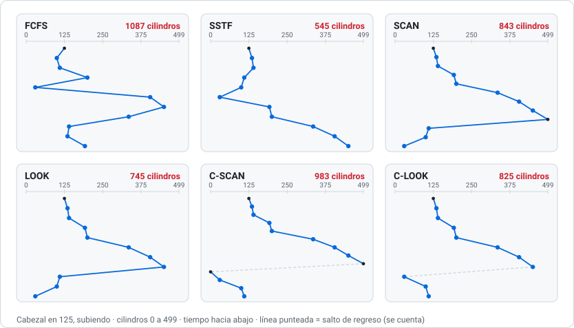

# 08 · Disco, sistema de archivos y protección

> **Aparece en:** P2 2025-2 (FAT, 20 pts), P2 2024-2 (transferencia RAM → disco, 20 pts) y en la guía (17, 20, 21, 22, 26, 28).

## 1. El disco duro

- Tiene **platos** con **superficies**; cada superficie tiene **pistas** concéntricas y cada pista tiene **sectores**. Las pistas que están a la misma distancia en todas las superficies forman un **cilindro**.
- Leer un sector cuesta:

$$t_{\text{acceso}} = \underbrace{t_{\text{búsqueda}}}_{\text{mover el brazo (seek)}} + \underbrace{t_{\text{rotación}}}_{\text{esperar el sector}} + \underbrace{t_{\text{transferencia}}}_{\text{leer los bytes}}$$

- La **búsqueda** (mover el brazo) es lo más caro. Por eso se planifica el orden de las solicitudes: para **minimizar el recorrido del cabezal**.

## 2. Planificación del brazo del disco

| Algoritmo | Regla | Comentario |
|---|---|---|
| **FCFS** | En el orden en que llegaron | Justo, pero da saltos enormes |
| **SSTF** | La más **cercana** a la posición actual | Mucho mejor, pero puede dejar **en inanición** a las lejanas |
| **SCAN** (ascensor) | Avanza en una dirección atendiendo todo **hasta el final del disco**, y vuelve | Uniforme |
| **LOOK** | Como SCAN, pero se devuelve en la **última solicitud**, sin llegar al borde | Ahorra el tramo al borde |
| **C-SCAN** | Avanza hasta el final, **salta al cilindro 0** y sigue en la **misma** dirección | Tiempo de espera más parejo |
| **C-LOOK** | Como C-SCAN, pero llega solo hasta la última solicitud y salta a la **más baja** | |

> **Convenciones que debes declarar en la prueba:** (1) si cuentas el **salto de regreso** de C-SCAN y C-LOOK (aquí **sí** se cuenta) y (2) cuál es el último cilindro (el disco de 500 cilindros va del 0 al 499). `python herramientas/disco.py` usa estas convenciones.

### Guía, problema 20

> 500 cilindros (0 a 499), cabezal en **125**, dirección **ascendente**. Cola: 100, 110, 200, 30, 405, 450, 335, 140, 135, 192.

| Algoritmo | Orden en que se atienden | Cilindros recorridos |
|---|---|---|
| FCFS | 125 → 100 → 110 → 200 → 30 → 405 → 450 → 335 → 140 → 135 → 192 | **1.087** |
| SSTF | 125 → 135 → 140 → 110 → 100 → 30 → 192 → 200 → 335 → 405 → 450 | **545** |
| SCAN | 125 → 135 → 140 → 192 → 200 → 335 → 405 → 450 → **499** → 110 → 100 → 30 | **843** |
| LOOK | 125 → 135 → 140 → 192 → 200 → 335 → 405 → 450 → 110 → 100 → 30 | **745** |
| C-SCAN | 125 → … → 450 → **499 → 0** → 30 → 100 → 110 | **983** (con el salto) |
| C-LOOK | 125 → … → 450 → **30** → 100 → 110 | **825** (con el salto) |

**Cómo se calcula** (ejemplo LOOK): sube de 125 a 450, que son **325** cilindros; baja de 450 a 30, que son **420**. Total = 745.

**SSTF paso a paso:** desde 125, lo más cerca es 135 (10) y no 110 (15); desde 135 → 140; desde 140, 110 está a 30 y 192 a 52, así que va a 110; luego 100 y 30, y recién después sube hasta 450.

### Guía, problemas 22 y 26

| | Problema 22 (pistas 0 a 120, inicio 75, sube) | Problema 26 (pistas 0 a 139, inicio 25, sube) |
|---|---|---|
| FCFS | 420 | 784 |
| SSTF | 153 | 236 |
| SCAN | 153 (la solicitud 120 ya es el borde) | 238 (llega hasta 139) |
| LOOK | 153 | 236 |
| C-SCAN | 231 (salto 120 → 0) | 268 (139 → 0) |
| C-LOOK | 207 (salto 120 → 12) | 236 (salto 138 → 15) |

> En el 22, el enunciado dice "Total de pistas: 120" pero hay una solicitud a la pista **120**; se asume que las pistas van de 0 a 120. Escribe tu supuesto.

### Guía 17: brazo del disco y sistema de archivos

La forma de **asignar los bloques** de los archivos cambia cuánto se mueve el brazo:

- Con **asignación contigua**, un archivo se lee sin mover casi el brazo.
- Con **enlazada o indexada** (FAT), los bloques pueden quedar **repartidos** por todo el disco y cada lectura es una búsqueda.
- Los **directorios, la FAT o los i-nodos** se leen muy seguido. Conviene ponerlos **en los cilindros del medio**, cerca de los datos, y no en un extremo.
- Agrupar los bloques de un archivo (*clusters*, grupos de cilindros) y usar **caché** de bloques reduce las solicitudes que llegan al disco.

Por eso, el algoritmo de planificación del brazo se elige **junto con** el método de asignación: si el sistema de archivos ya mantiene los datos juntos, hasta FCFS funciona aceptablemente; si los dispersa, conviene SSTF o la familia SCAN.

## 3. Asignación de espacio a los archivos

| Método | Cómo funciona | Ventaja | Desventaja |
|---|---|---|---|
| **Contigua** | Bloques seguidos (inicio + largo) | Lectura muy rápida; acceso directo fácil | Fragmentación externa; cuesta hacer crecer el archivo |
| **Enlazada** | Cada bloque apunta al siguiente | Sin fragmentación externa | Acceso directo lento; un puntero dañado pierde el resto |
| **FAT** | Los punteros "siguiente bloque" en una **tabla** aparte (FAT) | Acceso directo recorriendo la tabla en memoria | La tabla ocupa espacio y es crítica |
| **Indexada** (i-nodos) | Un bloque índice con la lista de bloques del archivo | Acceso directo rápido | Gasta un bloque índice por archivo |

## 4. Ejercicio de FAT: P2 2025-2, Pregunta 3 (20 pts)

> 1 superficie, 5 pistas, 10 sectores por pista, sectores de 256 B. Directorio de 10 entradas de 512 B. FAT con punteros de 16 bits (2 B), guardada en paquetes de 512 B. Clusters de 512 B. Archivo de 2 KB.

| Pregunta | Cálculo | Resultado |
|---|---|---|
| a) Capacidad del disco | 1 × 5 × 10 × 256 | **12.800 B** |
| b) Nº de clusters | 12.800 / 512 | **25 clusters** |
| c) Tamaño del directorio | 10 × 512 | **5.120 B** |
| d) Tamaño de la FAT | 25 entradas × 2 B = 50 B → se redondea a un paquete de 512 | **512 B** |
| e) Área de datos | 12.800 − 5.120 − 512 | **7.168 B** |
| f) Clusters del archivo | 2 × 1024 = 2.048 B; 2.048 / 512 | **4 clusters** |
| g) Espacio asignado y fragmentación | 4 × 512 = 2.048 B; 2.048 − 2.048 | **2.048 B y 0 B** de fragmentación |
| h) Overhead del archivo | FAT de su cadena: 4 × 2 = 8 B → 512 B (un paquete); entrada de directorio: 512 B | **1.024 B** |
| i) ¿Cabe? | 2.048 ≤ 7.168 | **Sí** (quedan 5.120 B) |

> Si el archivo no fuera múltiplo del cluster (por ejemplo, 2.100 B), ocuparía **5** clusters (techo de 4,1) y la fragmentación sería 5 × 512 − 2.100 = 460 B.

## 5. Espacio libre

| Método | Cómo | Tamaño |
|---|---|---|
| **Mapa de bits** | 1 bit por bloque (1 = libre) | `nº de bloques / 8` bytes. Fijo |
| **Lista enlazada** | Cada bloque libre apunta al siguiente libre | En el peor caso (todo libre), una dirección por bloque |
| **Agrupamiento** | Un bloque guarda las direcciones de *n* bloques libres | |
| **Conteo** | (primer bloque libre, cuántos seguidos) | Bueno si hay tramos largos libres |

### Guía, problema 21

> Disco de 40 MB, bloques de 2 KB, direcciones de 16 bits. Espacio **máximo** del registro de bloques libres.

- Bloques: 40 MB / 2 KB = 40 × 1024 / 2 = **20.480 bloques**.
- **a) Mapa de bits:** 20.480 bits / 8 = 2.560 B = **2,5 KB** (cabe en 2 bloques). Es fijo: no depende de cuántos estén libres.
- **b) Lista enlazada de bloques:** el peor caso es con **todos** libres: 20.480 direcciones × 2 B = 40.960 B = **40 KB** (20 bloques, a 1.024 direcciones de 16 bits por bloque de 2 KB).

> Conclusión típica: el mapa de bits ocupa menos cuando el disco está casi vacío, y la lista ocupa menos cuando está casi lleno (hay pocos bloques libres que listar).

## 6. Transferencia RAM → disco: P2 2024-2, Problema 4 (20 pts)

> Archivo de 1 GB. RAM a 6 GB/s, disco externo a 150 MB/s.

- Pasa todo a MB: 1 GB = 1.024 MB; 6 GB/s = 6.144 MB/s.
- Lectura desde la RAM: 1.024 / 6.144 ≈ **0,167 s**.
- Escritura en el disco: 1.024 / 150 ≈ **6,83 s**.
- **Conclusión:** el tiempo total queda **limitado por el componente más lento** (el disco): ≈ **6,83 s**. La RAM es 40 veces más rápida, pero no sirve de nada si el disco no recibe los datos a esa velocidad. Es un **cuello de botella**.

> Si las dos etapas fueran estrictamente una después de la otra (sin traslape), serían 0,167 + 6,83 ≈ 7,0 s. Lo normal es que se traslapen (DMA y búferes), y por eso la pauta da ≈ 6,83 s.

## 7. Protección: dominios y matriz de acceso

- **Dominio de protección:** un conjunto de pares (objeto, derechos), por ejemplo (archivo X, {leer, escribir}). Un proceso trabaja dentro de un dominio (por ejemplo, el de su usuario).
- **Matriz de acceso:** filas = **dominios**, columnas = **objetos**, celda = **derechos** (R = leer, W = escribir, X = ejecutar).
- En la práctica se guarda por columnas (**listas de control de acceso**, ACL, en cada objeto) o por filas (**listas de capacidades** de cada dominio).

### Guía, problema 28

Tomando "acceso total" = RWX y, para las impresoras, W = imprimir:

| Dominio | E1-E3 | E4-E6 | Láser L1 | Tinta I1 | Tinta I2 | BD B1 | BD B2 |
|---|---|---|---|---|---|---|---|
| **Jefaturas** | RWX | — | W | W | — | RWX | RWX |
| **Operarios** | — | RWX | — | — | W | — | RWX |
| **Administradores** | RWX | RWX | — | — | W | RX | RX |

> En el enunciado, "acceso a todos los **equipos**" de los administradores se interpreta como las estaciones E1-E6. Lo importante en la prueba es **declarar cómo interpretas cada permiso** y armar la matriz de forma consistente.
