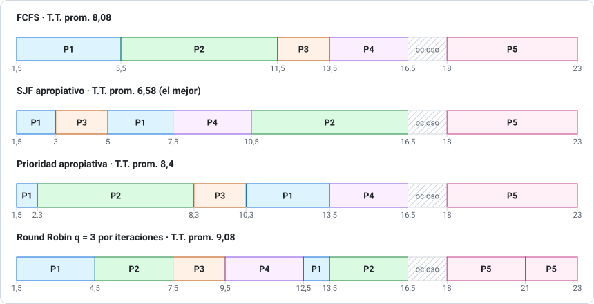
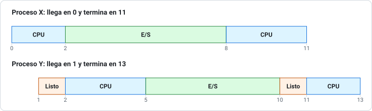
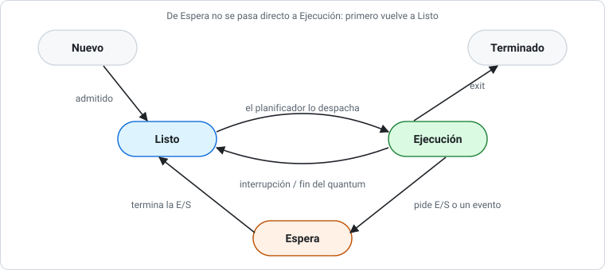

# Pauta del ensayo 2 de Prueba 1

> Los resultados del problema 1 se obtuvieron con [`herramientas/planificacion.py`](../herramientas/planificacion.py). Corrige con honestidad: si te faltó la justificación, no te des el puntaje completo.

## Problema 1 (40 pts)

### i) Diagramas de Gantt (6 pts c/u)

**La trampa de este ejercicio:** todos los procesos terminan en 16,5 y P5 recién llega en 18. La CPU queda **ociosa de 16,5 a 18** en los cuatro algoritmos. P5 no puede partir antes de llegar.

**FCFS:** en orden de llegada, sin interrupciones, con el tiempo ocioso antes de P5.

**SJF Preemptive (SRTF), las decisiones clave:**

| Instante | Qué pasa | Decisión |
|---|---|---|
| 1,5 | Llega P1 (4) | Corre P1 |
| 2,3 | Llega P2 (6); a P1 le quedan 3,2 | Sigue P1 |
| 3,0 | Llega P3 (2); a P1 le quedan **2,5** | 2 < 2,5 → **P3 expulsa a P1** |
| 4,8 | Llega P4 (3); a P3 le quedan 0,2 | Sigue P3 |
| 5,0 | Termina P3. Esperan P1 (2,5), P4 (3), P2 (6) | Corre **P1** |
| 7,5 | Termina P1 | P4 (3) y después P2 (6) |
| 18 | Llega P5 | Corre P5 hasta 23 |

**Priority Preemptive, las decisiones clave:**

| Instante | Qué pasa | Decisión |
|---|---|---|
| 1,5 | Llega P1 (prioridad 3) | Corre P1 |
| 2,3 | Llega P2 (prioridad 1) | **P2 expulsa a P1** (a P1 le quedan 3,2) |
| 3,0 y 4,8 | Llegan P3 (2) y P4 (4) | Sigue P2 |
| 8,3 | Termina P2. Esperan P3 (2), P1 (3), P4 (4) | P3, luego P1, luego P4 |
| 18 | Llega P5 (prioridad 0) | Corre P5 hasta 23 |

**Round Robin q = 3 por iteraciones** (orden de llegada P1, P2, P3, P4, P5):

| Vuelta | Tramos |
|---|---|
| 1 | P1 1,5–4,5 · P2 4,5–7,5 · P3 7,5–9,5 (termina) · P4 9,5–12,5 (termina) |
| 2 | P1 12,5–13,5 (termina) · P2 13,5–16,5 (termina) |
| — | CPU ociosa 16,5–18 |
| 3 | P5 18–21 · P5 21–23 (termina) |

> Con la **cola del libro**, P1 vuelve antes que P4: el orden es P1, P2, P3, P1, P4, P2. Promedios con la cola: T.T. 8,68 y W.T. 4,68 (6,48). Si usaste la cola, escríbelo; el razonamiento vale igual.

### ii) Tiempos (12 pts)

`T.T. = fin − llegada` · `W.T. = T.T. − ráfaga` · entre paréntesis, el W.T. calculado como en las pautas (inicio del último tramo − llegada) cuando da distinto.

| Proceso | FCFS T.T. / W.T. | SJF-P T.T. / W.T. | Prioridad-P T.T. / W.T. | RR q=3 T.T. / W.T. |
|---|---|---|---|---|
| P1 | 4,0 / 0,0 | 6,0 / 2,0 (3,5) | 12,0 / 8,0 (8,8) | 12,0 / 8,0 (11,0) |
| P2 | 9,2 / 3,2 | 14,2 / 8,2 | 6,0 / 0,0 | 14,2 / 8,2 (11,2) |
| P3 | 10,5 / 8,5 | 2,0 / 0,0 | 7,3 / 5,3 | 6,5 / 4,5 |
| P4 | 11,7 / 8,7 | 5,7 / 2,7 | 11,7 / 8,7 | 7,7 / 4,7 |
| P5 | 5,0 / 0,0 | 5,0 / 0,0 | 5,0 / 0,0 | 5,0 / 0,0 (3,0) |
| **Promedio** | **8,08 / 4,08** | **6,58 / 2,58** (2,88) | **8,4 / 4,4** (4,56) | **9,08 / 5,08** (6,88) |

> **Ojo con P5 en RR:** nunca espera, porque está solo, pero la fórmula de las pautas da 3,0: tiene dos tramos y cuenta como espera el primero. La espera real es 0.

> **Comprobación rápida:** suma de ráfagas = 4 + 6 + 2 + 3 + 5 = 20. Parte en 1,5, hay 1,5 de ocio y todo termina en 1,5 + 20 + 1,5 = **23**. ✓

### iii) El mejor (4 pts)

**SJF apropiativo**: menor turnaround promedio (6,58) y menor espera promedio (2,58). Atiende primero a quien le falta menos, así que P3, P1 y P4 salen rápido.

Costo: **P2**, el más largo del primer grupo, espera 8,2 y podría sufrir **inanición** si siguieran llegando trabajos cortos. Además, en la práctica hay que **estimar** las ráfagas.

---

## Problema 2 (15 pts)

### a) Línea de tiempo (6 pts)

| Instante | Qué pasa |
|---|---|
| 0 | Llega X y usa la CPU hasta 2 |
| 1 | Llega Y y espera |
| 2 | X pasa a E/S hasta 8. Y usa la CPU hasta 5 |
| 5 | Y pasa a E/S hasta 10. **Nadie está listo: CPU ociosa** |
| 8 | Termina la E/S de X. X usa la CPU hasta 11 |
| 10 | Termina la E/S de Y. **Y espera**, porque FCFS no expulsa a X |
| 11 | Termina X. Y usa la CPU hasta 13 |

### b) Retorno y espera (4 pts)

| Proceso | Fin | Retorno = fin − llegada | Espera en la cola de listos |
|---|---|---|---|
| X | 11 | 11 − 0 = **11** | **0** |
| Y | 13 | 13 − 1 = **12** | (2 − 1) + (11 − 10) = **2** |

> **Comprobación:** espera = retorno − CPU − E/S. X: 11 − 5 − 6 = 0. Y: 12 − 5 − 5 = 2. ✓

### c) Utilización (2 pts)

Sí, la CPU está **ociosa de 5 a 8** (3 ut). Trabaja 10 de 13 ut: **10 / 13 ≈ 76,9 %**.

### d) Transiciones de Y (3 pts)

| Instante | Transición | Motivo |
|---|---|---|
| 1 | Nuevo → Listo | Admitido; la CPU está ocupada |
| 2 | Listo → Ejecución | Despachado (CPU 3) |
| 5 | Ejecución → Espera | Pide E/S (5) |
| 10 | Espera → Listo | Termina la E/S |
| 11 | Listo → Ejecución | Despachado (CPU 2) |
| 13 | Ejecución → Terminado | Fin |

---

## Problema 3 (20 pts)

**a) (5 pts)** Aumenta la **utilización de la CPU**: hay varios procesos cargados y, cuando uno espera E/S, la CPU ejecuta otro. La **multitarea** extiende esa idea: la CPU cambia de proceso con tanta frecuencia que los usuarios pueden interactuar con cada programa mientras se ejecuta, lo que busca un **tiempo de respuesta** corto.

**b) (5 pts)** **No, en ninguno de los dos casos.** Siempre hay cambio a modo kernel y se guarda el estado de la CPU, pero solo hay cambio de contexto si el SO termina ejecutando **otro** proceso; por ejemplo, si la llamada bloquea al proceso o si la interrupción marca el fin del quantum.

**c) (5 pts)** Haciendo **privilegiadas** las instrucciones de E/S. Solo se pueden ejecutar en modo kernel, así que los procesos deben pedírselo al SO con llamadas al sistema. Si lo intentan en modo usuario, el hardware genera una trap.

**d) (5 pts)** Implementan el manejo de un controlador específico (registros, comandos e interrupciones) y traducen pedidos genéricos a órdenes del hardware. **Sí son parte del SO**: corren en modo kernel, con acceso directo al hardware.

---

## Problema 4 (25 pts)

**a) (6 pts)**

| Transición | Causa |
|---|---|
| Nuevo → Listo | El proceso es admitido |
| Listo → Ejecución | El despachador le da la CPU |
| Ejecución → Listo | Interrupción: vence el quantum o lo expulsa otro proceso |
| Ejecución → Espera | Pide E/S o espera un evento |
| Espera → Listo | Termina la E/S u ocurre el evento |
| Ejecución → Terminado | Termina su ejecución |

Cuando termina la espera, la CPU puede estar ocupada, y además **solo el planificador asigna la CPU**. Por eso el proceso vuelve primero a la cola de **Listos** y compite con los demás.

**b) (6 pts)** Existen **6 procesos** y se imprime **6 veces** "hola".

| Paso | Qué ocurre | Procesos |
|---|---|---|
| Primer `fork()` | Lo ejecuta el original | 2 |
| `fork()` del `if` | Lo ejecutan los 2; cada uno crea un hijo | 4 |
| `fork()` interno | Solo lo ejecutan los 2 hijos recién creados, porque para ellos `fork()` devolvió 0 | 6 |

Los 6 procesos llegan al `printf`.

**c) (4 pts)** El hijo imprime **20** y el padre imprime **5**. `fork()` le da al hijo una **copia** del espacio de direcciones, así que cambiar su `x` no afecta la del padre. No se pide sincronización: el `wait(NULL)` solo asegura que el hijo imprima primero.

**d) (4 pts)** Un proceso de baja prioridad puede **esperar indefinidamente** si siempre hay procesos de mayor prioridad listos. Se evita con **envejecimiento (aging)**: se aumenta gradualmente la prioridad de los procesos que llevan mucho tiempo esperando.

**e) (5 pts)**

| Planificador | Qué hace |
|---|---|
| **Largo plazo** | Decide qué trabajos se admiten en memoria; controla el grado de multiprogramación |
| **Corto plazo** | Elige cuál proceso listo recibe la CPU |
| **Mediano plazo** | Saca procesos de memoria y los vuelve a cargar después (*swapping*) para reducir la multiprogramación |

El de **corto plazo** es el más frecuente, porque actúa cada vez que hay que asignar la CPU: en cada expulsión, bloqueo o término. Por eso debe ser muy rápido.

---

**Puntaje:** P1 40 + P2 15 + P3 20 + P4 25 = **100**. Con 60 puntos tienes un 4,0.
