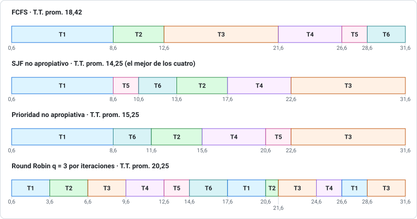
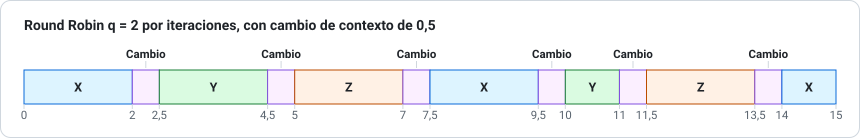

# Pauta del ensayo 3 de Prueba 1

> Los resultados del problema 1 se obtuvieron con [`herramientas/planificacion.py`](../herramientas/planificacion.py). Corrige con honestidad: si te faltó la justificación, no te des el puntaje completo.

## Problema 1 (40 pts)

### i) Diagramas de Gantt (5 pts c/u)

**La trampa de este ejercicio:** en los tres no apropiativos, cuando T1 parte en 0,6 **nadie lo interrumpe** hasta 8,6, aunque lleguen procesos más cortos o más prioritarios. Recién en 8,6 se elige entre todos los demás.

**SJF no apropiativo:** en 8,6 esperan todos. Se ordenan por ráfaga: T5 (2), T6 (3), T2 (4), T4 (5), T3 (9).

**Prioridad no apropiativa:** en 8,6 se ordenan por prioridad: T6 (0), T2 (1), T4 (2), T5 (4), T3 (5).

**Round Robin q = 3 por iteraciones** (orden de llegada T1, T2, T3, T4, T5, T6):

| Vuelta | Tramos |
|---|---|
| 1 | T1 0,6–3,6 · T2 3,6–6,6 · T3 6,6–9,6 · T4 9,6–12,6 · T5 12,6–14,6 (termina) · T6 14,6–17,6 (termina) |
| 2 | T1 17,6–20,6 · T2 20,6–21,6 (termina) · T3 21,6–24,6 · T4 24,6–26,6 (termina) |
| 3 | T1 26,6–28,6 (termina) · T3 28,6–31,6 (termina) |

> Con la **cola del libro**, T1 vuelve antes que T5 y T6. Promedios con la cola: T.T. 21,25 y W.T. 16,08 (19,08). Si usaste la cola, escríbelo; el razonamiento vale igual.

### ii) Tiempos (12 pts)

`T.T. = fin − llegada` · `W.T. = T.T. − ráfaga` · entre paréntesis, el W.T. calculado como en las pautas (inicio del último tramo − llegada) cuando da distinto.

| Proceso | FCFS T.T. / W.T. | SJF NA T.T. / W.T. | Prioridad NA T.T. / W.T. | RR q=3 T.T. / W.T. |
|---|---|---|---|---|
| T1 | 8,0 / 0,0 | 8,0 / 0,0 | 8,0 / 0,0 | 28,0 / 20,0 (26,0) |
| T2 | 11,2 / 7,2 | 16,2 / 12,2 | 14,2 / 10,2 | 20,2 / 16,2 (19,2) |
| T3 | 18,9 / 9,9 | 28,9 / 19,9 | 28,9 / 19,9 | 28,9 / 19,9 (25,9) |
| T4 | 23,3 / 18,3 | 19,3 / 14,3 | 17,3 / 12,3 | 23,3 / 18,3 (21,3) |
| T5 | 23,7 / 21,7 | 5,7 / 3,7 | 17,7 / 15,7 | 9,7 / 7,7 |
| T6 | 25,4 / 22,4 | 7,4 / 4,4 | 5,4 / 2,4 | 11,4 / 8,4 |
| **Promedio** | **18,42 / 13,25** | **14,25 / 9,08** | **15,25 / 10,08** | **20,25 / 15,08** (18,08) |

> **Comprobación rápida:** suma de ráfagas = 8 + 4 + 9 + 5 + 2 + 3 = 31, y todos los Gantt van de 0,6 a 31,6 sin tiempo ocioso. ✓

### iii) El mejor de los cuatro (4 pts)

**SJF no apropiativo**: menor turnaround promedio (14,25) y menor espera promedio (9,08). Al elegir la ráfaga más corta, T5 y T6 salen rápido y bajan los promedios.

Su costo es que T3, el más largo, espera 19,9. RR tiene el peor promedio, pero **ningún proceso espera tanto para recibir la CPU por primera vez**, así que tiene mejor tiempo de respuesta.

### iv) SJF Preemptive (4 pts)

| Instante | Qué pasa | Decisión |
|---|---|---|
| 0,6 | Llega T1 (8) | Corre T1 |
| 1,4 | Llega T2 (4); a T1 le quedan **7,2** | **T2 expulsa a T1** |
| 2,7 y 3,3 | Llegan T3 (9) y T4 (5) | Sigue T2 |
| 4,9 | Llega T5 (2); a T2 le quedan **0,5** | Sigue T2 |
| 5,4 | Termina T2 | Corre T5 (2) |
| 6,2 | Llega T6 (3); a T5 le quedan 1,2 | Sigue T5 |
| 7,4 | Termina T5 | T6 (3), T4 (5), T1 (7,2) y T3 (9) |

**Gantt:** `0,6 T1 1,4 T2 5,4 T5 7,4 T6 10,4 T4 15,4 T1 22,6 T3 31,6`

| Proceso | T1 | T2 | T3 | T4 | T5 | T6 | **Promedio** |
|---|---|---|---|---|---|---|---|
| T.T. | 22,0 | 4,0 | 28,9 | 12,1 | 2,5 | 4,2 | **12,28** |

**Sí mejora** (12,28 < 14,25). T1 ya no bloquea a los procesos cortos que llegan después. El costo es que T1 pasa de esperar 0 a esperar 14,0.

---

## Problema 2 (15 pts)

### a) Gantt y turnaround (5 pts)

| Proceso | Fin | T.T. = fin − llegada |
|---|---|---|
| X | 15 | 15 − 0 = **15** |
| Y | 11 | 11 − 1 = **10** |
| Z | 13,5 | 13,5 − 2 = **11,5** |
| **Promedio** | | 36,5 / 3 = **12,17** |

### b) Tiempo perdido (3 pts)

Hay **6 cambios** de 0,5 ut, es decir, 3 ut. El tiempo total es 15 ut (12 de CPU + 3 de cambios): **3 / 15 = 20 %**.

### c) Sin costo (3 pts)

**Gantt:** `0 X 2 Y 4 Z 6 X 8 Y 9 Z 11 X 12`

T.T.: X = 12, Y = 8, Z = 9. **Promedio = 29 / 3 = 9,67.**

El costo de los cambios sube el turnaround promedio de 9,67 a 12,17, aunque el trabajo útil sea el mismo. Por eso **q no debe ser demasiado chico** en comparación con el costo del cambio de contexto.

### d) Transiciones de Y (4 pts)

| # | Instante | Transición | Motivo |
|---|---|---|---|
| 1 | 1 | Nuevo → Listo | Admitido |
| 2 | 2,5 | Listo → Ejecución | Despachado (tras el cambio de contexto) |
| 3 | 4,5 | Ejecución → Listo | **Vence el quantum** |
| 4 | 10 | Listo → Ejecución | Despachado |
| 5 | 11 | Ejecución → Terminado | Fin |

> Y nunca pasa por **Espera**, porque no hace E/S.

---

## Problema 3 (20 pts)

**a) (4 pts)** Tres cualesquiera, con una línea cada uno: ejecución de programas; operaciones de E/S; manejo del sistema de archivos; comunicaciones; detección de errores; asignación de recursos; contabilidad; protección.

**b) (4 pts)** Varios procesadores que **comparten memoria, reloj y bus**, y se comunican por memoria compartida. Lo contrario es un sistema **débilmente acoplado** (distribuido), cuyos nodos se comunican por mensajes en red.

**c) (4 pts)** **Proteger las secciones críticas del propio SO**, porque varias CPU pueden ejecutar código del sistema al mismo tiempo sobre las mismas estructuras de datos.

**d) (4 pts)** Un proceso **más grande que la memoria física no puede ejecutarse**, porque debe cargarse completo. **Sí** puede haber multiprogramación, pero limitada a los procesos que quepan **completos** a la vez.

**e) (4 pts)** Una **interrupción** la genera el hardware, de forma asíncrona; por ejemplo, el fin de una E/S o el timer. Una **trap** es una "interrupción por software", causada por el programa en ejecución; por ejemplo, una división por cero o una llamada al sistema.

---

## Problema 4 (25 pts)

**a) (4 pts)** Un **programa** es una entidad pasiva, un archivo en disco. Un **proceso** es un programa en ejecución, una entidad activa con contador de programa y recursos. Sus partes en memoria son **texto, datos, heap y pila**.

**b) (5 pts)**

| Llamada | Qué hace |
|---|---|
| `fork` | Crea un proceso hijo, copia del padre |
| `exec` | Reemplaza la imagen del proceso por un programa nuevo |
| `wait` | El padre espera a que termine un hijo y recibe su estado |

Un proceso queda **zombi** si terminó y su padre aún no ha hecho `wait`. Queda **huérfano** si su padre muere antes que él.

**c) (5 pts)** **Comparten** el código, los datos y los archivos abiertos. **Cada hilo tiene** su propia pila, sus registros y su contador de programa.

Dos beneficios, entre: mejor capacidad de respuesta; compartir recursos fácilmente; menor costo que crear procesos; aprovechar varios núcleos.

**d) (5 pts)** $\tau_{n+1} = \alpha\, t_n + (1-\alpha)\,\tau_n$, con α = 0,25:

| n | Ráfaga real tₙ | Estimación previa τₙ | Nueva estimación τₙ₊₁ |
|---|---|---|---|
| 0 | 4 | 8 | τ₁ = 0,25·4 + 0,75·8 = **7** |
| 1 | 12 | 7 | τ₂ = 0,25·12 + 0,75·7 = **8,25** |
| 2 | 6 | 8,25 | τ₃ = 0,25·6 + 0,75·8,25 = **7,6875** |

Con **α = 0**, la estimación nunca cambia: se ignoran las ráfagas reales. Con **α = 1**, se usa solo la última ráfaga real.

**e) (6 pts)**

- **Quantum:** la regla pide que cerca del **80 % de las ráfagas sean más cortas que q**. De las 10 ráfagas, 8 son menores que 7 (2, 3, 3, 4, 4, 5, 6 y 6), así que **q = 7 ms**.
- **CPU perdida:** 1 / (7 + 1) = **12,5 %**.
- **Espera máxima:** los otros 19 procesos, cada uno con 7 + 1 ms: 19 × 8 = **152 ms**.
- **Si q = 1 ms:** se pierde 1 / (1 + 1) = **50 %** de la CPU en cambios de contexto.
- **Si q es mayor que todas las ráfagas:** ninguna vence el quantum y RR **se convierte en FCFS**.

---

**Puntaje:** P1 40 + P2 15 + P3 20 + P4 25 = **100**. Con 60 puntos tienes un 4,0.
