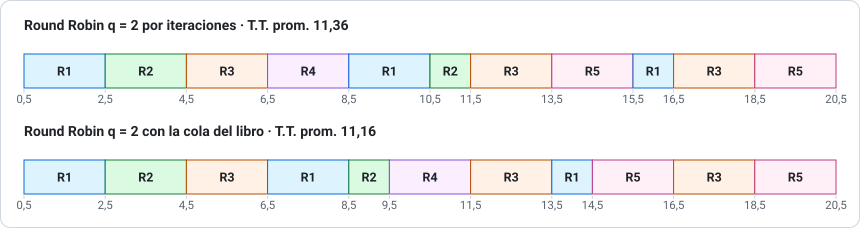
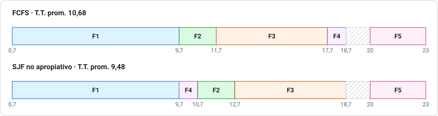

# Pauta del ensayo 4 de Prueba 1

> Los problemas 1, 2, 3 y 5 se obtuvieron con [`herramientas/planificacion.py`](../herramientas/planificacion.py). Corrige con honestidad: si te faltó la justificación, no te des el puntaje completo.
>
> `T.T. = fin − llegada` · `W.T. = T.T. − ráfaga` · **W.T. pauta** = inicio del último tramo − llegada, como calculan las pautas del curso. Si el proceso nunca se interrumpe, ambos coinciden.

## Problema 1: SJF no apropiativo (20 pts)

### a) Gantt (8 pts)

J1 corre completo. En 7,2 esperan todos los demás y se ordenan por ráfaga: J3 (1), J5 (2), J4 (3), J2 (4).

### b) Tiempos (8 pts)

| Proceso | T.T. | W.T. |
|---|---|---|
| J1 | 6,0 | 0,0 |
| J2 | 15,2 | 11,2 |
| J3 | 5,1 | 4,1 |
| J4 | 8,7 | 5,7 |
| J5 | 4,5 | 2,5 |
| **Promedio** | **7,9** | **4,7** |

### c) (4 pts)

Porque SJF **no apropiativo** no interrumpe al proceso en ejecución: J1 conserva la CPU hasta terminar en 7,2, aunque llegue una ráfaga más corta. Con SJF Preemptive, J3 sí expulsaría a J1.

---

## Problema 2: SJF Preemptive (20 pts)

### a) Gantt (10 pts)

| Instante | Qué pasa | Decisión |
|---|---|---|
| 0,3 | Llega A (7) | Corre A |
| 1,0 | Llega B (5); a A le quedan **6,3** | 5 < 6,3 → **B expulsa a A** |
| 1,8 | Llega C (2); a B le quedan **4,2** | 2 < 4,2 → **C expulsa a B** |
| 2,5 | Llega D (1); a C le quedan **1,3** | 1 < 1,3 → **D expulsa a C** |
| 3,5 | Termina D. Esperan C (1,3), B (4,2), A (6,3) | Corre C |
| 4,8 | Termina C | Corre B (4,2) |
| 6,2 | Llega E (3); a B le quedan **2,8** | 2,8 < 3 → **sigue B** |
| 9,0 | Termina B | E (3) y después A (6,3) |

### b) Tiempos (8 pts)

| Proceso | T.T. | W.T. | W.T. pauta |
|---|---|---|---|
| A | 18,0 | 11,0 | 11,7 |
| B | 8,0 | 3,0 | 3,8 |
| C | 3,0 | 1,0 | 1,7 |
| D | 1,0 | 0,0 | 0,0 |
| E | 5,8 | 2,8 | 2,8 |
| **Promedio** | **7,16** | **3,56** | **4,0** |

> **Comprobación rápida:** suma de ráfagas = 7 + 5 + 2 + 1 + 3 = 18, y el Gantt va de 0,3 a 18,3 sin tiempo ocioso. ✓

### c) (2 pts)

**No.** A B le quedan 9,0 − 6,2 = **2,8**, menos que la ráfaga de 3 de E. Se compara con lo que **queda**, no con la ráfaga original de B (5).

---

## Problema 3: Round Robin q = 2 (20 pts)

### a) Gantt (10 pts)

Por iteraciones, en orden de llegada (R1, R2, R3, R4, R5):

| Vuelta | Tramos |
|---|---|
| 1 | R1 0,5–2,5 · R2 2,5–4,5 · R3 4,5–6,5 · R4 6,5–8,5 (termina) |
| 2 | R1 8,5–10,5 · R2 10,5–11,5 (termina) · R3 11,5–13,5 · R5 13,5–15,5 |
| 3 | R1 15,5–16,5 (termina) · R3 16,5–18,5 (termina) · R5 18,5–20,5 (termina) |

> R5 llega en 9,0, durante la vuelta 2, y como es el último en orden de llegada se atiende al final de esa vuelta. En la vuelta 1 aún no había llegado.

### b) Tiempos (8 pts)

| Proceso | T.T. | W.T. | W.T. pauta |
|---|---|---|---|
| R1 | 16,0 | 11,0 | 15,0 |
| R2 | 10,3 | 7,3 | 9,3 |
| R3 | 16,5 | 10,5 | 14,5 |
| R4 | 2,5 | 0,5 | 0,5 |
| R5 | 11,5 | 7,5 | 9,5 |
| **Promedio** | **11,36** | **7,36** | **9,76** |

> **Con la cola del libro,** R1 y R2 vuelven antes que R4. Promedios: T.T. **11,16**, W.T. **7,16** y W.T. pauta **9,56**. Si usaste la cola, escríbelo; el razonamiento vale igual.

### c) (2 pts)

En **FCFS**: cada proceso termina dentro de su primer quantum y nadie es expulsado.

---

## Problema 4: Teórico (20 pts)

**a) (5 pts)** La llamada la hace el proceso **en modo usuario**. La trap cambia a **modo monitor (kernel)**, el SO la atiende con privilegios y **vuelve a modo usuario** antes de devolverle el control al proceso.

**b) (5 pts)** Es **guardar el estado del proceso que sale y cargar el del que entra**. Es tiempo perdido (*overhead*) porque, mientras ocurre, no se ejecuta trabajo útil de ningún proceso. El estado, incluidos los registros y el contador de programa, se guarda en el **PCB**, y por eso el proceso puede continuar exactamente donde quedó.

**c) (5 pts)** El **DMA** (acceso directo a memoria) permite que el controlador transfiera un bloque entre el dispositivo y la memoria **sin la CPU**, que solo inicia la operación y recibe una interrupción al final. Sin DMA, la CPU queda **ocupada durante toda la transferencia**, no puede atender otros procesos y se pierde gran parte del beneficio de la multiprogramación.

**d) (5 pts)** Es óptimo porque da el **menor tiempo de espera promedio** para un conjunto dado de procesos: adelantar un proceso corto le baja la espera más de lo que se la sube al largo. Su dificultad es que **no se conoce la próxima ráfaga** y hay que estimarla, por ejemplo con un promedio exponencial. Su riesgo es la **inanición** de los procesos largos si siguen llegando procesos cortos.

---

## Problema 5: FCFS y SJF (20 pts)

### a) Gantt (8 pts)

En ambos, F1 corre completo porque ninguno de los dos algoritmos lo interrumpe. **La CPU está ociosa de 18,7 a 20**, porque F5 recién llega en 20.

### b) Tiempos (6 pts)

| Proceso | FCFS T.T. / W.T. | SJF T.T. / W.T. |
|---|---|---|
| F1 | 9,0 / 0,0 | 9,0 / 0,0 |
| F2 | 10,2 / 8,2 | 11,2 / 9,2 |
| F3 | 15,5 / 9,5 | 16,5 / 10,5 |
| F4 | 15,7 / 14,7 | 7,7 / 6,7 |
| F5 | 3,0 / 0,0 | 3,0 / 0,0 |
| **Promedio** | **10,68 / 6,48** | **9,48 / 5,28** |

### c) (6 pts)

**SJF es mejor**: baja el turnaround promedio de 10,68 a 9,48 y la espera de 6,48 a 5,28.

**Sí hay procesos que empeoran:** F2 y F3 esperan 1 ut más, porque F4 pasa antes que ellos. La mejora de F4 (8 ut menos) compensa con creces esa pérdida.

El **efecto convoy** ocurre cuando procesos cortos quedan esperando detrás de uno largo. Aquí F2, F3 y F4 llegan mientras corre F1 (9 ut), y **ambos algoritmos lo sufren**: como no son apropiativos, nadie puede interrumpir a F1.

---

**Puntaje:** P1 20 + P2 20 + P3 20 + P4 20 + P5 20 = **100**. Con 60 puntos tienes un 4,0.
