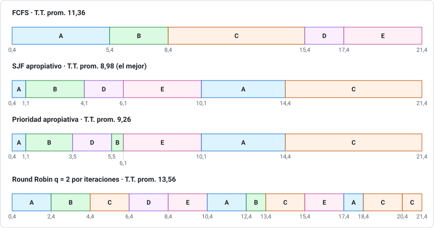

# Pauta del ensayo de Prueba 1

> Los resultados numéricos se verificaron con [`herramientas/planificacion.py`](../herramientas/planificacion.py). Corrige con honestidad: si te faltó la justificación, no te des el puntaje completo.

## Problema 1 (40 pts)

### i) Diagramas de Gantt (6 pts c/u)

**FCFS:** en orden de llegada, sin interrupciones.

**SJF Preemptive (SRTF), las decisiones clave:**

| Instante | Qué pasa | Decisión |
|---|---|---|
| 0,4 | Llega A (5) | Corre A |
| 1,1 | Llega B (3); a A le quedan **4,3** | 3 < 4,3 → **B expulsa a A** |
| 2,0 | Llega C (7); a B le quedan 2,1 | Sigue B |
| 3,5 | Llega D (2); a B le quedan 0,6 | Sigue B |
| 4,1 | Termina B. Esperan A (4,3), C (7), D (2) | Corre **D** |
| 4,2 | Llega E (4); a D le quedan 1,9 | Sigue D |
| 6,1 | Termina D. Esperan A (4,3), C (7), E (4) | Corre **E** (4 < 4,3) |
| 10,1 | Termina E | Corre A (4,3) y después C |

**Priority Preemptive, las decisiones clave:**

| Instante | Qué pasa | Decisión |
|---|---|---|
| 1,1 | Llega B (prioridad 1) mientras corre A (3) | **B expulsa a A** |
| 3,5 | Llega D (prioridad 0) | **D expulsa a B** (a B le quedan 0,6) |
| 4,2 | Llega E (2) | Sigue D (0 es más prioritario) |
| 5,5 | Termina D. Esperan B (1), E (2), A (3), C (4) | Corre B |
| 6,1 | Termina B | E (2), luego A (3), luego C (4) |

**Round Robin q = 2 por iteraciones** (orden de llegada A, B, C, D, E):

| Vuelta | Tramos |
|---|---|
| 1 | A 0,4–2,4 · B 2,4–4,4 · C 4,4–6,4 · D 6,4–8,4 (termina) · E 8,4–10,4 |
| 2 | A 10,4–12,4 · B 12,4–13,4 (termina) · C 13,4–15,4 · E 15,4–17,4 (termina) |
| 3 | A 17,4–18,4 (termina) · C 18,4–20,4 |
| 4 | C 20,4–21,4 (termina) |

> Con la **cola del libro** el orden cambia desde 6,4: A vuelve antes que D. Promedios con la cola: T.T. 13,76 y W.T. 9,56. Si usaste la cola, escríbelo; el razonamiento vale igual.

### ii) Tiempos (12 pts)

`T.T. = fin − llegada` · `W.T. = T.T. − ráfaga` · entre paréntesis, el W.T. calculado como en las pautas (inicio del último tramo − llegada) cuando da distinto.

| Proceso | FCFS T.T. / W.T. | SJF-P T.T. / W.T. | Prioridad-P T.T. / W.T. | RR q=2 T.T. / W.T. |
|---|---|---|---|---|
| A | 5,0 / 0,0 | 14,0 / 9,0 (9,7) | 14,0 / 9,0 (9,7) | 18,0 / 13,0 (17,0) |
| B | 7,3 / 4,3 | 3,0 / 0,0 | 5,0 / 2,0 (4,4) | 12,3 / 9,3 (11,3) |
| C | 13,4 / 6,4 | 19,4 / 12,4 | 19,4 / 12,4 | 19,4 / 12,4 (18,4) |
| D | 13,9 / 11,9 | 2,6 / 0,6 | 2,0 / 0,0 | 4,9 / 2,9 |
| E | 17,2 / 13,2 | 5,9 / 1,9 | 5,9 / 1,9 | 13,2 / 9,2 (11,2) |
| **Promedio** | **11,36 / 7,16** | **8,98 / 4,78** (4,92) | **9,26 / 5,06** (5,68) | **13,56 / 9,36** (12,16) |

> **Comprobación rápida:** suma de ráfagas = 5 + 3 + 7 + 2 + 4 = 21, y todos los Gantt van de 0,4 a 21,4 sin tiempo ocioso. ✓

### iii) El mejor (4 pts)

**SJF apropiativo**: menor turnaround promedio (8,98) y menor espera promedio (4,78). Siempre atiende primero al que le falta menos, así que los trabajos cortos (B, D, E) salen rápido y bajan los promedios. Es el óptimo teórico en tiempo de espera.

Costo: **C**, el más largo, espera más (12,4) y podría sufrir **inanición** si siguieran llegando trabajos cortos. Además, en la práctica hay que **estimar** las ráfagas.

---

## Problema 2 (15 pts)

### a) Línea de tiempo y retorno (5 pts)

Con prioridad máxima nadie lo interrumpe: 2 + 3 + 4 + 2 + 1 + 5 = termina en **17**.
**Tiempo de retorno = 17 − 2 = 15 ut.** Las E/S cuentan, porque el proceso sigue en el sistema.

### b) Transiciones (6 pts)

| # | Transición | Motivo |
|---|---|---|
| 1 | Nuevo → Listo | Admitido |
| 2 | Listo → Ejecución | Despachado (CPU 3) |
| 3 | Ejecución → Espera | Pide E/S (4) |
| 4 | Espera → Listo | Termina la E/S |
| 5 | Listo → Ejecución | Despachado (CPU 2) |
| 6 | Ejecución → Espera | Pide E/S (1) |
| 7 | Espera → Listo | Termina la E/S |
| 8 | Listo → Ejecución | Despachado (CPU 5) |
| 9 | Ejecución → Terminado | Fin |

> De **Espera** se vuelve a **Listo**, nunca directo a Ejecución (−2 pts si se salta).

### c) Con RR q = 2 y P solo (4 pts)

Aparecen transiciones **Ejecución → Listo → Ejecución** cada vez que vence el quantum con la ráfaga sin terminar:

- **Ráfaga de 3:** corre 2, vence el quantum (Ejecución → Listo → Ejecución) y corre 1.
- **Ráfaga de 2:** cabe justo en el quantum. Termina y pide E/S, así que **no** hay transición extra.
- **Ráfaga de 5:** 2 + 2 + 1, así que hay **dos** idas a Listo.

**El tiempo de retorno no cambia (15)**: como P está solo, vuelve a ejecutar de inmediato; solo se suma el costo de los cambios de contexto, que aquí se desprecia.

---

## Problema 3 (20 pts)

**a) (5 pts)** La llamada la hace el proceso **en modo usuario**. La instrucción de llamada (trap) cambia a **modo monitor (kernel)**; el SO atiende el pedido con privilegios y, **antes de devolverle el control, vuelve a modo usuario**. Esquema: `proceso (usuario) → trap → SO atiende (kernel) → retorno (usuario)`.

**b) (5 pts)** Sin timer, el SO solo recupera la CPU cuando el proceso hace una llamada al sistema o termina. Un proceso con un **ciclo infinito** (o simplemente largo) **nunca soltaría la CPU**, así que no habría tiempo compartido ni Round Robin, y un programa podría colgar el sistema. El timer genera una interrupción periódica que le devuelve el control al SO. Programarlo es una instrucción privilegiada.

**c) (5 pts)**
- **Simétrico (SMP):** todos los procesadores son iguales y cualquiera ejecuta código de usuario o del SO.
- **Asimétrico:** un procesador maestro ejecuta el SO y reparte el trabajo a los esclavos.

En un SMP de 4 procesadores, el SO puede ejecutarse en **cualquiera** de ellos, sin restricción. Por eso debe proteger sus propias secciones críticas.

**d) (5 pts)** La CPU quedaría **ocupada durante toda la transferencia** y no podría ejecutar otros procesos mientras dura la E/S. La multiprogramación existe precisamente para aprovechar la CPU durante la E/S, así que **pierde casi todo su beneficio**. Con DMA, la CPU solo inicia la transferencia y recibe **una interrupción al final del bloque**.

---

## Problema 4 (25 pts)

**a) (4 pts)** Para **guardar** los registros, incluido el contador de programa, cuando el proceso pierde la CPU, y **restaurarlos** cuando vuelve a ejecutar. Así continúa exactamente donde quedó: es el **cambio de contexto**.

**b) (4 pts)** Si un hilo se **bloquea en E/S**, el SO puede ejecutar **otro hilo del mismo proceso**, porque los reconoce como unidades independientes. Con hilos solo de usuario, el SO ve un solo proceso y **se bloquea completo**. (No hay paralelismo real: es una sola CPU.)

**c) (7 pts)** Por cada ráfaga de q ms se pierden 0,5 ms en el cambio, así que el desperdicio es `0,5 / (q + 0,5)`. Un proceso espera, como máximo, a los otros 9: `9 × (q + 0,5)`.

| q | CPU perdida | Espera máxima para volver a ejecutar |
|---|---|---|
| 2 ms | 0,5 / 2,5 = **20 %** | 9 × 2,5 = **22,5 ms** |
| 10 ms | 0,5 / 10,5 = **4,8 %** | 9 × 10,5 = **94,5 ms** |
| 50 ms | 0,5 / 50,5 = **1,0 %** | 9 × 50,5 = **454,5 ms** |

Con la exigencia de **< 100 ms**, se elige **q = 10 ms**: cumple (94,5 ms) y pierde poco (4,8 %). Con q = 2 se cumple, pero se desperdicia el 20 % de la CPU; con q = 50 no se cumple.

**d) (6 pts)** $\tau_{n+1} = \alpha\, t_n + (1-\alpha)\,\tau_n$, con α = 0,5:

| n | Ráfaga real tₙ | Estimación previa τₙ | Nueva estimación τₙ₊₁ |
|---|---|---|---|
| 0 | 6 | 10 | τ₁ = 0,5·6 + 0,5·10 = **8** |
| 1 | 4 | 8 | τ₂ = 0,5·4 + 0,5·8 = **6** |
| 2 | 6 | 6 | τ₃ = 0,5·6 + 0,5·6 = **6** |
| 3 | 13 | 6 | τ₄ = 0,5·13 + 0,5·6 = **9,5** |

Con la ráfaga de 13 la estimación **sube, pero solo hasta la mitad del salto** (de 6 a 9,5). Con α = 0,5 el pasado pesa lo mismo que la última ráfaga, así que un valor atípico no la dispara. Con α = 1 se usaría solo la última ráfaga; con α = 0, se ignoraría la historia reciente.

**e) (4 pts)**

| | Memoria compartida | Paso de mensajes |
|---|---|---|
| Cómo funciona | Zona común que ambos leen y escriben | `send` / `receive` a través del SO |
| Ventaja | **Muy rápida**: el SO solo interviene al crearla | **Más simple y segura**; sirve **entre máquinas** |
| Desventaja | Hay que **sincronizar** a mano (condiciones de carrera) | **Más lenta**: una llamada al sistema por mensaje |

---

**Puntaje:** P1 40 + P2 15 + P3 20 + P4 25 = **100**. Con 60 puntos tienes un 4,0.
